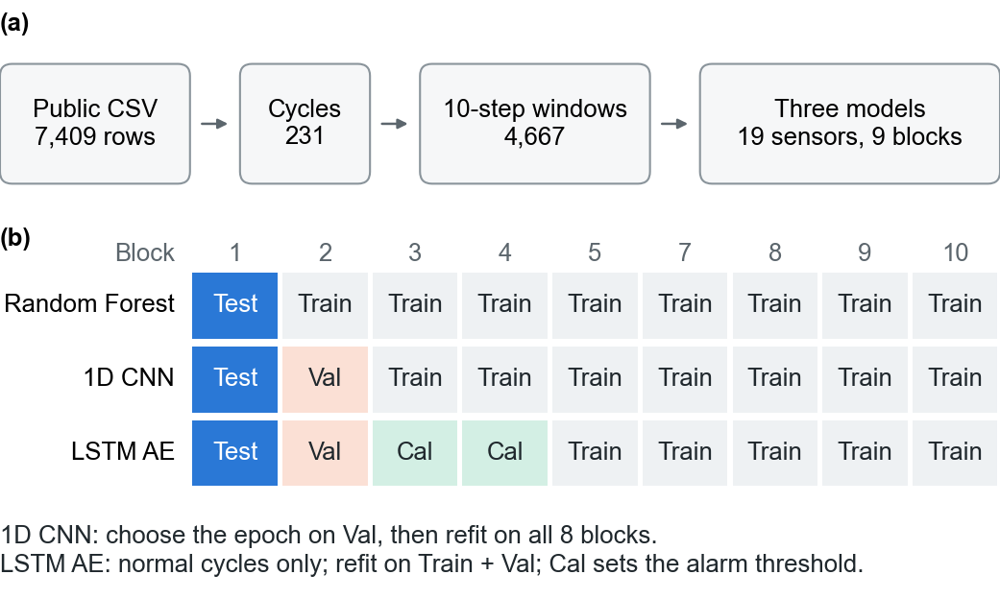
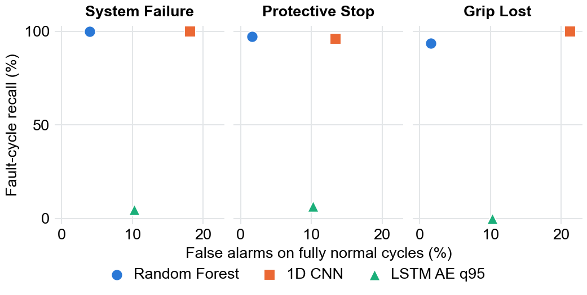

# UR3 CobotOps 로봇팔 센서 데이터의 이상탐지를 위한 시계열 맥락 반영과 딥러닝 모델 비교 연구

남궁도현, 김택명

가톨릭대학교 인공지능학과

# Temporal Context and Deep Learning Model Comparison for Anomaly Detection in UR3 CobotOps Robot Arm Sensor Data

Dohyun Namgung, Taekmyung Kim

Department of Artificial Intelligence, The Catholic University of Korea

Abstract

An earlier course project classified the fault state of a UR3 collaborative robot from single time points in the public UR3 CobotOps sensor records. Random row splits can place neighboring observations from one cycle in both training and evaluation, and single time points ignore the order of sensor values. We asked whether temporal context and deep learning improve detection when whole cycles and acquisition blocks are held out. The records were divided into 231 cycles and 4,667 overlapping 10-step windows. Using the same 19 sensors and nine held-out acquisition blocks, we compared a Random Forest on window statistics, a 1D CNN on raw sequences, and an LSTM Autoencoder trained on normal data. For Grip Lost, the Random Forest detected 45 of 48 fault cycles and the 1D CNN 48 of 48, but the 1D CNN alarmed on 27 of 127 fully normal cycles against 2 of 127. The Autoencoder's recall was 0 to 6.58% across three targets at its main threshold. Removing the current sensors lowered Random Forest detection of Grip Lost from 45 to 26 of 48. In these data the benefit of temporal context appeared in window statistics, and raw-sequence deep learning added none. The results come from one robot's public data and describe detection of fault-containing windows, not early warning.

Key words: UR3 CobotOps, Multivariate time series, Anomaly detection, Cycle-aware split, Random Forest, 1D CNN, LSTM Autoencoder

Roles as stated in the scholarship application. Principal investigator: Dohyun Namgung. Co-investigator: Taekmyung Kim.

## I. 서 론

협동로봇은 사람과 같은 공간에서 일할 수 있도록 힘과 출력을 제한하고, 예상하지 못한 접촉이 있으면 바로 멈춘다. 이런 안전 기능 때문에 작업 중 보호 정지가 일어나기도 하고, 힘이 제한된 상태에서 작업물을 놓치는 파지 상실이 생기기도 한다 [1]. UR3 CobotOps는 이 두 고장을 기록한 공개 데이터로, UR3 협동로봇이 물건을 집어 옮기는 작업에서 관절 전류, 온도, 속도와 그리퍼 전류를 저장하였다 [1,2].

이 데이터를 공개한 Tyrovolas 등은 두 고장 중 하나라도 있으면 고장으로 보는 System Failure를 정의하고, 정보 흐름 기반 퍼지 인지 지도(IF-FCM)와 기존 FCM을 비교하였다 [1]. 설명 가능성에 초점을 둔 연구로, SMOTE-ENN과 층화 10겹 교차검증을 사용하면서 이 방식이 시계열 순서를 훼손할 수 있다고 저자들이 직접 밝혔다 [1]. Yaşar Çıklaçandır 등은 같은 데이터에서 로지스틱 회귀, 의사결정나무, 랜덤 포레스트, SVM, KNN과 RFE·카이제곱 특징 선택을 비교하였고, 70:30 분할에서 특징 선택 전 랜덤 포레스트 정확도 0.9848(보호 정지)과 0.9898(파지 상실)을 보고하였다 [3]. Taş와 Bal은 보호 정지 분류에 BiRNN과 하이퍼파라미터 최적화를 적용하면서 자료를 행 기준 무작위 80:20으로 나누었다 [4]. 두 연구에는 사이클이나 수집 구간을 통째로 떼어 둔 평가가 제시되어 있지 않다.

Shen 등은 70/15/15의 시간순 분할에서 Transformer와 ODE 기반 모델로 고장 분류와 잔여 수명(RUL) 예측을 함께 수행하였다 [5]. 본 연구와 가까운 방향이지만, 고장 상태가 이어지는 구간을 RUL 라벨에서 어떻게 처리했는지는 기술되어 있지 않고, 사이클별 표준화(standardized per cycle)가 미래 시점의 통계를 쓰는지도 본문만으로는 확인할 수 없다. 대상은 다르지만 Pinto Neto는 WAY-EEG-GAL 자료에서 고전적 스펙트럼 디코더와 CNN, Transformer, GNN을 피험자를 한 명씩 제외하는 같은 평가(LOSO)로 비교하였다 [6]. 작은 다변량 시계열에서 모델 복잡도를 우위로 전제하지 않고 modality와 bandwidth 등의 대조 조건을 명시한 이 설계를 방법론의 참고로 삼았다.

같은 데이터를 써도 분할 방식과 평가 단위에 따라 성능 수치가 답하는 질문은 달라진다. 개별 행을 무작위로 나누면 같은 사이클에서 시간상 가까운 관측값이 학습과 평가에 함께 들어갈 수 있다. 기존 머신러닝 수업 프로젝트도 한 시점의 센서값으로 고장 상태를 분류하고 랜덤 포레스트 등 고전 모델을 비교한 것이어서 이 문제에서 자유롭지 않았다. 그래서 본 연구에서는 사이클과 수집 구간을 나누어 평가하고, 시간 순서를 직접 입력받는 딥러닝 모델이 기존 접근을 개선하는지 살펴보았다. 초기 시계열 비교에서 1D CNN과 LSTM 분류기는 많은 고장 사이클을 탐지했지만, 해당 고장이 없는 사이클에서 랜덤 포레스트보다 자주 경보하였다. 이 관찰이 경보를 나누어 보는 계기가 되었다.

본 연구가 답하려는 질문은 개별 시점 중심의 기본 머신러닝 모델과 비교할 때, 시계열 맥락을 반영한 데이터 표현과 딥러닝 모델이 이상 상태 탐지 성능과 해석 가능성을 개선하는가이다. 연구계획서에서 정한 이 질문을 다섯으로 나누었다. 첫째, 행 단위 입력과 비교해 시계열 구간 표현은 탐지 성능을 개선하는가. 둘째, 정상 데이터로 학습한 LSTM 오토인코더는 기본 머신러닝 모델 대비 어떤 장점과 한계를 보이는가. 셋째, 1D CNN은 센서 구간의 시간적 패턴을 탐지에 효과적으로 활용하는가. 넷째, 통합 라벨과 개별 고장 유형의 분석은 어떤 차이를 보이는가. 다섯째, 전류, 속도, 온도, 그리퍼 전류 중 어떤 센서 그룹이 고장 탐지와 더 밀접한가.

이 질문에 답하기 위해 세 가지를 갖추었다. 첫째, 연속 시행과 수집 블록을 보존해 같은 시행의 관측값이 학습과 평가에 함께 들어가지 않게 하였다. 둘째, 고장 구간 탐지와 고장 전 예측을 분리하고, 경보를 완전 정상 사이클의 오경보와 다른 고장에 대한 교차 경보로 나누었다. 셋째, 센서 그룹 제거 실험의 조건과 해석 규칙을 결과 확인 전에 고정하였다. 본 연구는 새로운 모델 구조를 제안하지 않는다. 주 결과는 고장 상태가 포함된 구간의 탐지이며, 최초 양성 시점 이전의 기록만 쓰는 고장 전 예측은 별도의 탐색 분석으로 다룬다.

## II. 연구 방법

### 1. 연구 설계

연구 과정은 그림 1과 같다. 공개 기록을 사이클과 구간으로 나눈 뒤, 같은 19개 센서와 같은 9개 수집 블록 분할에서 모델을 비교하였다(그림 1a). 블록을 하나씩 시험용으로 떼어 두고, 나머지 블록의 역할은 모델의 학습 방식에 따라 달리하였다(그림 1b).

그림 1. 연구 설계. (a) 공개 기록에서 모델 비교까지의 처리 (b) 시험 블록이 1번일 때 모델별 블록 역할의 예. 다른 블록을 시험용으로 둘 때도 같은 구조를 따른다
Fig. 1. Study design. (a) From public records to model comparison (b) Example of block roles by model when block 1 is the test block. The same structure applies when another block is held out

연구계획서와 달라진 점은 다음과 같다. 행 단위 기준 모델은 랜덤 포레스트로만 재현했고, 로지스틱 회귀와 RBF SVM은 구간 통계 특징에서 비교하였다. 재구성 오차 기반 모델은 계획서의 LSTM/GRU 오토인코더 중 LSTM을 사용하였다. 랜덤 분할과 사이클 분할의 비교는 탐색 단계에서 한 번 수행하였다. 사이클 분할에서 랜덤 포레스트의 Macro F1은 통합 고장 0.8013→0.7901, 파지 상실 0.7988→0.7623으로 낮아졌지만 보호 정지는 0.7921→0.8428로 높아져 방향이 일정하지 않았다. 이후의 모든 비교는 사이클과 수집 블록 단위로 분할하였다. 오탐·미탐 사례 분석은 개별 사례 대신 완전 정상 오경보와 교차 고장 경보의 건수로 정리하였다. 구간 수준의 혼동 행렬과 정밀도는 계산했으나 본문에는 사이클 단위 지표를 우선 제시한다.

### 2. 데이터와 탐지 대상

UCI Machine Learning Repository의 UR3 CobotOps 데이터 [2]를 사용하였다. 공개 CSV는 7,409행 24열이다. 모델 입력은 관절 J0~J5의 전류·온도·속도와 그리퍼 전류(Tool current)를 합친 원본 센서 19개이다. 탐지 대상은 보호 정지(Protective Stop), 파지 상실(Grip Lost), 둘 중 하나라도 있으면 양성인 통합 고장(System Failure)의 세 가지이며, 각각 별도의 이진 탐지 문제로 평가하였다.

자료를 살펴보고 네 가지를 평가 설계에 반영하였다. 첫째, 통합 고장 라벨은 양성 518행, 음성 6,837행, 결측 54행으로 양성이 적다. 전체 정확도만으로는 성능을 알기 어려우므로 Macro F1, PR-AUC, 고장 사이클 재현율을 함께 보고한다. 둘째, 863행은 타임스탬프가 큰따옴표로 한 번 더 감싸여 있었다. 따옴표를 제거한 뒤 시각으로 변환해 모든 행을 같은 기준으로 정렬하였다. 셋째, 일부 사이클 번호는 시간상 떨어진 구간에서 다시 나타났다. 번호가 이어지는 구간마다 식별자(cycle_run)를 새로 붙였고, 최종 비교에 들어간 231개 구간을 이 논문에서는 사이클이라 부른다. 넷째, 양의 타임스탬프 간격의 중앙값은 1.005초였으나 긴 간격도 있었다. 그래서 입력 길이는 초가 아니라 저장된 관측값의 개수인 스텝(step)으로 적는다.

고장 사이클은 통합 고장 104개, 보호 정지 76개, 파지 상실 48개이다. 완전 정상 사이클은 모든 평가 구간에서 통합 고장 라벨이 0인 사이클로 정의하였고 127개이다.

### 3. 구간과 라벨

사이클 안에서 10스텝 구간을 한 칸씩 옮겨 가며 만들었다. 구간은 사이클 경계를 넘지 않는다. 구간은 모두 4,667개지만 서로 겹치므로 독립 표본 수로 보지 않는다. 구간의 라벨은 구간 안에 있는 라벨의 최댓값이다. 따라서 양성 구간은 고장이 일어난 시점을 포함할 수 있고, 주 결과는 고장 예측이 아니라 고장이 든 구간의 탐지이다.

행 단위 기준 모델과의 초기 비교에서는 5, 10, 20스텝을 탐색하였다. 이후의 모델 비교에서는 결과를 확인하기 전에 10스텝을 공통 입력으로 고정하였다. RTDE 인터페이스의 125 Hz와 공개 CSV의 실제 저장 간격이 같지 않으므로, 10스텝은 약 10초라고 단정하지 않고 저장된 관측값 10개로 해석한다.

### 4. 분할과 누수 통제

Tyrovolas 등은 작업물 하중, 동작 속도, 파지력의 조합마다 25회 반복했다고 기술하였다 [1]. 이를 바탕으로 사이클 번호를 25개씩 묶어 수집 블록을 만들고, 충분한 사이클이 남은 1, 2, 3, 4, 5, 7, 8, 9, 10번 블록을 사용하였다. 각 블록을 한 번씩 시험 블록으로 두고, 나머지 8개를 모델별 학습, 검증, 임계값 보정에 사용하였다. 표준화, SMOTE, 에폭 선택, 임계값 보정은 모두 시험 블록 밖에서 수행하였다.

이 블록은 실제 공정조건의 정답이 아니라 수집 구간을 대신하는 근사값이다. 공개 파일에는 사이클별 조건 대응표가 없고, 블록에는 온도와 세션 변화의 영향이 함께 들어 있을 수 있다. 따라서 평가 결과는 같은 데이터 안에서 수집 구간을 달리했을 때의 내부 일반화로 제한한다.

### 5. 비교 모델

랜덤 포레스트는 19개 센서마다 평균, 표준편차, 최솟값, 최댓값, 범위, 첫값과 끝값의 차이, 기울기를 계산한 133개 특징을 입력받는다. 학습 블록에만 SMOTE를 적용한 뒤 트리 300개로 학습하였고, random_state 42와 판정 기준 0.50을 사용하였다.

1D CNN은 시계열 분류에 쓰이는 구조 [7]로, 10×19 원시 구간을 그대로 입력받는다. Conv1D 19→32, Conv1D 32→64, 전역 평균 풀링, 드롭아웃 0.2, 선형 출력층으로 구성하였다. 클래스 가중 이진 교차 엔트로피, Adam, 학습률 1e-3, 가중치 감쇠 1e-4를 사용하였다. 학습 블록 중 1개로 에폭을 정한 뒤 8개 블록 전체로 다시 학습하였다.

LSTM [8] 오토인코더는 정상 구간을 복원하도록 학습하고 복원 오차로 이상을 판정한다 [9]. 단층 LSTM 인코더와 디코더의 은닉 크기는 각각 32이고 19개 센서를 복원한다. 분할마다 시험 1개, 검증 1개, 임계값 보정 2개, 초기 학습 5개 블록으로 나누었다. 초기 학습 블록의 완전 정상 사이클로 학습하고 검증 블록의 완전 정상 사이클로 에폭을 고른 뒤, 두 집합을 합친 6개 블록의 완전 정상 사이클로 다시 학습하였다. 보정용 2개 블록은 학습, 에폭 선택, 최종 표준화 계수 산출에서 제외하였다.

구간의 이상 점수는 표준화한 10개 시점과 19개 센서의 재구성 평균제곱오차이다. 보정 블록의 완전 정상 사이클마다 구간 점수의 최댓값을 구하고, 분할과 시드별로 이 최댓값 분포의 경험적 95백분위수를 주 임계값 q95로 정하였다(numpy.quantile, method=higher). 시험 구간의 점수가 임계값을 엄격히 넘으면 경보로 판정하였다. 같은 분할과 시드의 점수와 임계값을 세 탐지 대상에 공통으로 썼고, q90과 q97.5는 민감도 분석에 썼다.

1D CNN과 LSTM 오토인코더는 시드 42, 43, 44로 반복하였다. 세 시드 중 둘 이상이 경보한 사이클을 경보 사이클로 집계하였고, 둘 이상의 시드가 각각 실제 양성 구간에서 한 번 이상 경보한 경우를 탐지로 집계하였다. 랜덤 포레스트는 시드 42의 고정 결과를 사용하였다.

고전 모델끼리의 통제 비교로 같은 133개 특징에 로지스틱 회귀와 RBF SVM을 적용하였다. 학습 분할 안에서 StandardScaler와 SMOTE를 쓰고, 로지스틱 회귀는 L2, C=1, solver=saga를, RBF SVM은 C=1, gamma=scale을 사용하였다. 결과를 확인한 뒤 격자 탐색이나 판정 기준 조정은 추가하지 않았다.

### 6. 센서 그룹 제거 실험

랜덤 포레스트의 학습과 평가 조건을 유지하면서 입력 센서 그룹만 바꾸었다. 그룹은 관절 전류 6개, 관절 온도 6개, 관절 속도 6개, 그리퍼 전류 1개이고, 관절 전류와 그리퍼 전류를 합친 7개를 전류 계열이라 부른다. 전체 19개를 기준선으로, 한 그룹만 쓰는 단독 조건 5개와 한 그룹을 빼는 제거 조건 4개를 비교하였다.

비교 조건과 해석 규칙은 결과 확인 전에 고정하였다. 제거 조건에서 탐지가 줄거나 같고 오경보가 늘거나 같으며 둘 중 하나가 나빠지면, 그 그룹이 현재 모델에 기여했다는 기술적 근거로 본다. 두 지표의 방향이 엇갈리면 상충(trade-off)으로 기록하고 어느 쪽이 낫다고 주장하지 않는다. 단독 조건은 기준선과의 차이만 보고하며 충분 여부를 판정하지 않는다. 센서 그룹이 바뀌면 입력 차원과 SMOTE가 적용되는 특징 공간도 함께 달라진다.

### 7. 평가 지표

사이클 수준의 주 지표는 세 가지이다. 고장 사이클 재현율은 실제 양성 구간이 있는 사이클 중 그 양성 구간에서 경보한 사이클의 비율이다. 완전 정상 오경보율은 어떤 고장도 없는 사이클에서 경보가 발생한 비율이고, 교차 고장 경보율은 해당 고장은 없지만 다른 고장만 발생한 사이클에서 경보가 발생한 비율이다. 표에는 비율과 함께 건수와 분모를 적었다. 사이클 비율에는 Wilson 95% 신뢰구간을 계산하였다.

구간 수준에서는 Accuracy, Macro F1, 양성 클래스의 정밀도·재현율·F1, ROC-AUC, PR-AUC를 계산하였다. Macro F1은 고정 판정 기준에서 두 클래스의 F1을 같은 비중으로 평균한 값이다. PR-AUC(평균 정밀도)는 양성 구간의 점수 순위를 정밀도와 재현율로 요약하고, ROC-AUC는 양성과 음성을 얼마나 잘 구분하는지 보조로 제시한다. 블록은 같은 로봇 기록에서 나눈 평가 단위이므로 결과는 이 데이터 안의 기술적 비교로 해석한다.

## III. 연구 결과

### 1. 행 단위와 구간 단위의 초기 비교

세 탐지 대상 모두 구간 통계 특징의 Macro F1과 PR-AUC가 행 단위 기준 모델보다 높았다(표 1). PR-AUC는 통합 고장 0.6430에서 0.8927로, 보호 정지 0.7409에서 0.8796으로, 파지 상실 0.5604에서 0.7831로 올랐다. 다만 행과 구간은 평가 단위와 라벨 정의가 달라 이 차이를 탐색 결과로만 해석한다. 이후의 모델 비교는 10스텝으로 고정한 결과이다.

표 1. 탐지 대상별 구간 설정의 초기 탐색 결과
Table 1. Initial search results for window settings by target

| Target | Row Macro F1 | Best window | Window Macro F1 | Row PR-AUC | Window PR‑AUC |
|---|---|---|---|---|---|
| System Failure | 0.7901 | 20-step | 0.8860 | 0.6430 | 0.8927 |
| Protective Stop | 0.8428 | 5-step | 0.8776 | 0.7409 | 0.8796 |
| Grip Lost | 0.7623 | 10-step | 0.8244 | 0.5604 | 0.7831 |

Best window is the setting with the highest PR-AUC for each target in the initial search. Row and window results differ in evaluation unit and label definition.

### 2. 주 모델 비교

고장 탐지 수는 랜덤 포레스트와 1D CNN이 비슷했고, 차이는 경보 부담에서 나타났다(표 2, 그림 2). 통합 고장에서는 두 모델 모두 104/104개를 탐지하였다. 보호 정지는 각각 74/76과 73/76, 파지 상실은 45/48과 48/48이었다. 반면 파지 상실의 완전 정상 오경보는 랜덤 포레스트 2/127, 1D CNN 27/127이었고, 다른 고장만 발생한 사이클의 경보는 3/56과 22/56이었다. 1D CNN이 파지 상실을 모두 찾은 대신 완전 정상 사이클 다섯 개 중 한 개꼴로 경보했다는 뜻이다.

표 2. 주 모델별 고장 사이클 탐지와 경보 건수
Table 2. Fault-cycle detection and alert counts by main model

| Target | Model | Detected / fault cycles | False alarms / normal cycles | Alerts / other-fault cycles |
|---|---|---|---|---|
| System Failure | Random Forest | 104/104 (100.00%) | 5/127 (3.94%) | n/a |
|  | 1D CNN | 104/104 (100.00%) | 23/127 (18.11%) | n/a |
|  | LSTM AE q95 | 5/104 (4.81%) | 13/127 (10.24%) | n/a |
| Protective Stop | Random Forest | 74/76 (97.37%) | 2/127 (1.57%) | 0/28 (0.00%) |
|  | 1D CNN | 73/76 (96.05%) | 17/127 (13.39%) | 4/28 (14.29%) |
|  | LSTM AE q95 | 5/76 (6.58%) | 13/127 (10.24%) | 0/28 (0.00%) |
| Grip Lost | Random Forest | 45/48 (93.75%) | 2/127 (1.57%) | 3/56 (5.36%) |
|  | 1D CNN | 48/48 (100.00%) | 27/127 (21.26%) | 22/56 (39.29%) |
|  | LSTM AE q95 | 0/48 (0.00%) | 13/127 (10.24%) | 6/56 (10.71%) |

Normal cycles have no fault of any type. System Failure is the union of the two faults, so it has no other-fault category. AE, Autoencoder; q95, main threshold defined in Methods 5; n/a, not applicable.

몇 건 차이의 탐지 수는 우열로 해석하지 않는다. 파지 상실 탐지율의 Wilson 95% 구간은 랜덤 포레스트 83.2~97.9%, 1D CNN 92.6~100.0%로 겹친다. 반면 완전 정상 오경보율의 구간은 0.4~5.6%와 15.0~29.2%로 겹치지 않았다. 이 구간은 같은 블록 안 사이클 사이의 상관을 반영하지 않으므로 실제 불확실성은 더 클 수 있다. LSTM 오토인코더의 q95 탐지는 세 탐지 대상에서 5/104, 5/76, 0/48로 매우 적었다.

그림 2. 고장 사이클 재현율과 완전 정상 사이클 오경보율. 왼쪽 위에 가까울수록 오경보가 적고 재현율이 높다. 값은 표 2와 같고, 교차 고장 경보는 표 2에 제시하였다
Fig. 2. Fault-cycle recall and false-alarm rate on fully normal cycles. Points nearer the upper left have fewer false alarms and higher recall. Values match Table 2, which also lists cross-fault alerts

구간 수준의 보조 지표에서도 세 탐지 대상 모두 랜덤 포레스트가 가장 높았다(표 3). 파지 상실에서 랜덤 포레스트와 1D CNN의 Macro F1은 0.8159와 0.7580, PR-AUC는 0.7742와 0.6675, ROC-AUC는 0.9267과 0.9089였다. Macro F1은 각 모델의 고정 판정 기준으로, PR-AUC와 ROC-AUC는 판정 전 점수로 계산하였다. 표 2의 사이클 결과와는 평가 단위와 집계 방식이 다르다.

표 3. 주 모델의 구간 수준 보조 지표
Table 3. Window-level supporting metrics of the main models

| Target | Model | Macro F1 | PR-AUC | ROC-AUC |
|---|---|---|---|---|
| System Failure | Random Forest | 0.8482 | 0.8515 | 0.9288 |
|  | 1D CNN | 0.7888 | 0.7334 | 0.8827 |
|  | LSTM AE q95 | 0.4391 | 0.2237 | 0.4202 |
| Protective Stop | Random Forest | 0.8871 | 0.8706 | 0.9651 |
|  | 1D CNN | 0.8021 | 0.7877 | 0.9261 |
|  | LSTM AE q95 | 0.4821 | 0.1592 | 0.4599 |
| Grip Lost | Random Forest | 0.8159 | 0.7742 | 0.9267 |
|  | 1D CNN | 0.7580 | 0.6675 | 0.9089 |
|  | LSTM AE q95 | 0.4658 | 0.0866 | 0.3934 |

Predictions for the 4,667 windows from the nine test blocks are pooled per seed. Random Forest uses one fixed seed; the deep models are means over three seeds.

### 3. 고전 모델 통제 비교

같은 통계 특징에서 로지스틱 회귀는 탐지가 높았지만 경보가 많았고, RBF SVM은 경보를 줄였으나 탐지 대상별 상충이 남았다(표 4). 로지스틱 회귀의 완전 정상 오경보율은 0.2677에서 0.4724였다. RBF SVM은 보호 정지에서 이 값이 0.0000이었지만 파지 상실의 교차 고장 경보율은 0.3036이었다. 통계 특징에는 선형 모델과 커널 모델도 활용할 수 있는 신호가 있으나, 현재 조건에서는 랜덤 포레스트가 탐지와 경보 부담의 균형이 가장 안정적이었다.

표 4. 같은 통계 특징에서의 고전 모델 비교
Table 4. Classical models on the same window statistics

| Target | Model | Fault recall | True-normal false-alarm rate | Cross-fault alert rate |
|---|---|---|---|---|
| System Failure | Random Forest | 1.0000 | 0.0394 | n/a |
|  | Logistic Regression | 0.9904 | 0.4567 | n/a |
|  | RBF SVM | 0.9904 | 0.0787 | n/a |
| Protective Stop | Random Forest | 0.9737 | 0.0157 | 0.0000 |
|  | Logistic Regression | 0.9737 | 0.2677 | 0.2857 |
|  | RBF SVM | 0.9605 | 0.0000 | 0.0357 |
| Grip Lost | Random Forest | 0.9375 | 0.0157 | 0.0536 |
|  | Logistic Regression | 1.0000 | 0.4724 | 0.6964 |
|  | RBF SVM | 0.9583 | 0.0945 | 0.3036 |

All models use the same 133 window statistics. n/a, not applicable.

### 4. 센서 그룹 제거 실험

파지 상실의 탐지는 전류 계열에 크게 의존하였다(표 5). 전류 계열을 빼면 탐지가 45/48에서 26/48로 줄었고 완전 정상 오경보는 2/127에서 1/127로 한 건 적어져, 사전 규칙에 따라 상충으로 기록한다. 전류 계열이나 관절 전류만으로도 45/48을 탐지해 기준선과 같았지만, 완전 정상 오경보(5/127, 10/127)와 교차 경보(14/56)는 기준선(2/127, 3/56)보다 많았다. 온도만 쓰면 1/48만 탐지했고, 속도만 쓰면 46/48을 탐지했지만 완전 정상 오경보가 28/127이었다.

통합 고장과 보호 정지는 전류 계열을 빼도 탐지가 101/104와 75/76으로 크게 줄지 않았고, 완전 정상 오경보가 각각 5/127에서 11/127, 2/127에서 5/127로 늘었다. 보호 정지의 교차 경보도 0/28에서 4/28로 늘었다. 사전 규칙으로 보면 통합 고장은 전류 계열이 기여한 근거에 해당하고, 보호 정지는 탐지가 한 건 늘어 상충에 해당한다. 전류 계열을 뺐을 때 파지 상실에서는 탐지가, 나머지 둘에서는 오경보가 주로 달라진 것이다.

그리퍼 전류만 쓴 조건은 세 탐지 대상에서 완전 정상 사이클의 69~87%에 경보하였다. 그리퍼 전류는 이상이 생긴 뒤 변할 수 있으므로 구간 탐지에서의 유용성을 고장 전조로 해석하지 않는다. 온도도 수집 구간의 변화를 반영할 수 있어 단독 성능을 고장 메커니즘으로 해석하지 않는다. 관절 전류만 빼고 그리퍼 전류를 유지한 조건은 사전 목록에 없으므로, 관절 전류 제거의 효과는 따로 말할 수 없다.

표 5. 센서 그룹 조건별 랜덤 포레스트의 탐지와 경보 건수
Table 5. Random Forest detection and alert counts by sensor-group condition

| Condition | n | SF Det. /104 | SF FA /127 | PS Det. /76 | PS FA /127 | GL Det. /48 | GL FA /127 | GL Cross /56 |
|---|---|---|---|---|---|---|---|---|
| All sensors (baseline) | 19 | 104 | 5 | 74 | 2 | 45 | 2 | 3 |
| Current family only | 7 | 102 | 6 | 73 | 7 | 45 | 5 | 14 |
| Joint current only | 6 | 103 | 7 | 73 | 7 | 45 | 10 | 14 |
| Tool current only | 1 | 80 | 111 | 58 | 88 | 31 | 93 | 47 |
| Joint speed only | 6 | 102 | 30 | 75 | 9 | 46 | 28 | 23 |
| Joint temperature only | 6 | 24 | 14 | 10 | 7 | 1 | 0 | 1 |
| Drop current family | 12 | 101 | 11 | 75 | 5 | 26 | 1 | 3 |
| Drop joint speed | 13 | 102 | 5 | 72 | 3 | 44 | 3 | 6 |
| Drop joint temperature | 13 | 104 | 8 | 74 | 7 | 45 | 4 | 6 |
| Drop tool current | 18 | 104 | 6 | 74 | 3 | 45 | 1 | 5 |

n, number of sensors; SF, System Failure; PS, Protective Stop; GL, Grip Lost; Det., detected fault cycles; FA, false alarms on fully normal cycles; Cross, alerts on cycles with Protective Stop only. Current family is joint current plus tool current. Ten conditions were fixed before results.

### 5. 고장 전 예측 부가 분석

최초 양성 이전 구간만 쓴 30회 반복 분할에서 양성 F1 평균은 통합 고장 0.1178, 보호 정지 0.1344, 파지 상실 0.3758이었다. 파지 상실은 30회 모두에서 양성을 하나 이상 탐지했지만 평균 재현율은 0.2814였다. 약한 사전 신호가 있을 가능성은 남지만 실용적인 조기 경보 성능을 확보했다고 볼 수는 없다.

### 6. 공정조건 역추적

공정조건을 사이클에 다시 연결하지는 못하였다. Tyrovolas 등에는 작업물 하중 1, 2, 3 kg, 동작 속도 60, 80, 100%, 파지력 80, 100, 120 N과 조건당 25회 반복이 기술되어 있다 [1]. 그러나 공개 CSV에는 사이클별 조건표가 없고 가능한 27개 조합의 사용 여부도 제시되지 않았다. 센서 기반 군집화는 세 조건이 각각 세 수준으로 구분된다는 근거를 주지 못했고, 25사이클 후보 블록은 공정 센서보다 온도만으로 더 잘 구분되었다. 이 결과는 본 연구의 성과가 아니라 데이터 출처의 한계와 세션 변화 가능성을 확인한 점검 결과로 해석한다.

## IV. 고찰 및 결론

현재 자료에서 탐지와 경보 부담을 함께 보면 구간 통계 특징을 쓴 랜덤 포레스트의 균형이 가장 좋았고, 원시 시계열을 직접 받는 딥러닝은 추가 이득을 보이지 않았다. 시계열 맥락의 이점은 구간 통계 특징에서 관찰되었다. 다만 행과 구간의 비교에는 평가 단위와 라벨 정의, 입력 특징의 변화가 함께 들어 있어 개선 폭은 확정하지 않는다. 시계열 맥락 자체의 효과를 분리하려면 같은 평가 표본과 라벨을 쓴 통제 비교가 필요하다.

랜덤 포레스트와 1D CNN의 차이를 모델 구조만의 차이로 볼 수는 없다. 단일 로봇의 231개 사이클과 10스텝 입력에서 나온 결과이고, 입력 표현과 학습 목표, 임계값 설정의 차이가 함께 반영되어 있다. 모델 구조의 영향과 1D CNN이 다른 고장에 자주 경보한 원인을 구분하려면 별도의 통제 실험이 필요하다.

LSTM 오토인코더의 낮은 탐지는 임계값만의 문제로 보이지 않는다. 보정 블록의 완전 정상 사이클은 분할별로 13~38개였다. q90으로 임계값을 낮춰도 재현율은 통합 고장 0.0577, 보호 정지 0.0789, 파지 상실 0이었고, q97.5에서는 q95와 같았다. 구간 ROC-AUC는 0.39~0.46으로 0.5보다 낮았고, 시드 42 기준으로 분할별로 보아도 9개 중 7~8개에서 0.5 미만이었다. 고장이 포함된 구간의 재구성 오차가 그렇지 않은 구간보다 대체로 작았다는 뜻이므로 임계값 조정으로는 탐지가 개선되기 어렵다. 이 현상의 원인은 이번 분석에서 확인하지 않았다.

계획서의 핵심 질문에 있는 해석 가능성은 개별 모델의 내부 설명이 아니라 센서 그룹 제거 실험과 경보 유형의 분리로 살펴보았다. 그 결과 고장 유형마다 탐지가 의존하는 센서 그룹이 다르다는 점을 보고할 수 있었다. 다만 이 실험은 특징 차원과 SMOTE 공간을 함께 바꾸므로 인과적인 센서 중요도를 증명하지는 않는다.

본 연구에는 다음과 같은 한계가 있다. 첫째, 공개 데이터 하나와 UR3 한 대의 기록만 사용하였고, 9개 수집 블록도 독립적인 로봇이나 기관, 반복 실험이 아니므로 외부 일반화를 검증하지 못한다. 둘째, 공개 파일에는 사이클별 작업물 하중, 동작 속도, 파지력의 정답표가 없다. 셋째, 4,667개 구간은 서로 겹치므로 독립 표본 수가 아니며, 주 해석은 231개 사이클을 기준으로 한다. 넷째, 보호 정지와 파지 상실이 동시에 나타나는 행이 있어 단일 3분류 문제로 바꾸려면 별도의 처리 규칙이 필요하다. 다섯째, 랜덤 포레스트는 고정 시드 1회, 딥러닝은 시드 3개 합의이므로 초기화 반복 조건이 완전히 같지 않고, 오토인코더의 임계값 보정에 쓴 정상 사이클 수도 적다. 여섯째, 고장 전 예측 결과는 약한 탐색적 신호이며, 실시간 추론 지연, 연속 경보 정책, 새로운 고장 유형 대응은 검증하지 않았다. 일곱째, 완전 정상 사이클은 평가 구간 기준으로 정의하였으므로 127개 중 15개는 라벨이 결측된 행을 포함하며, 이 행은 구간 구성에서 제외되었다. 여덟째, 결측 행을 제외한 뒤 구간을 만들었기 때문에 4,667개 중 307개 구간은 빠진 행의 앞뒤 관측을 이어 붙였고, 60초 이상 간격을 포함한 구간도 3개 있다.

연구 질문에 차례로 답하면 다음과 같다. 첫째, 탐색 비교에서 세 탐지 대상 모두 구간 통계 특징의 Macro F1과 PR-AUC가 행 단위 기준 모델보다 높았으나, 평가 단위와 라벨이 달라 개선 폭은 확정하지 않는다. 둘째, 정상 데이터로 학습한 LSTM 오토인코더는 고장 라벨 없이 학습할 수 있지만, q95 기준 재현율이 세 탐지 대상에서 0~6.58%였고 구간 ROC-AUC도 0.5보다 낮았다. 셋째, 1D CNN은 랜덤 포레스트와 비슷하게 고장 사이클을 탐지했지만(파지 상실 48/48과 45/48), 완전 정상 오경보(27/127과 2/127)와 교차 고장 경보(22/56과 3/56)가 많았다. 넷째, 통합 라벨에서는 랜덤 포레스트와 1D CNN이 모두 104/104개를 탐지했지만, 개별 고장으로 나누면 다른 고장에 대한 경보와 센서 의존성의 차이가 드러났다. 다섯째, 파지 상실의 탐지는 전류 계열에 크게 의존해 이 계열을 빼면 45/48에서 26/48로 줄었고, 통합 고장과 보호 정지는 전류 계열 없이도 탐지가 크게 줄지 않은 대신 오경보가 늘었다.

결론적으로 이 공개 데이터의 내부 비교에서는 복잡한 모델이 곧 나은 탐지로 이어지지 않았고, 탐지율과 경보 부담을 함께 평가해야 모델의 차이가 드러났다. 다른 로봇으로의 일반화, 운전조건별 차이, 실용적인 조기 경보 성능은 추가 검증이 필요하다.

**데이터와 코드.** 공개 자료는 참고문헌 [2]에서 받을 수 있다. 분석에 쓴 파일의 SHA-256 앞 16자리는 C789CDA10ACB354A이다. CPU 환경은 Python 3.12.3, NumPy 2.4.3, pandas 3.0.3, scikit-learn 1.8.0, imbalanced-learn 0.14.1이고, 딥러닝 환경은 PyTorch 2.7.1+cu128, CUDA 12.8, NVIDIA GeForce RTX 3060 Ti이다. 시드는 랜덤 포레스트 42, 딥러닝 42, 43, 44이다. 분석 코드와 결과표는 연구 저장소의 research 폴더에 있으며, 표와 그림의 값은 이 결과표에서 가져왔다.

## References

[1] Tyrovolas M, Stylios C, Aliev K, Antonelli D. Leveraging information flow-based fuzzy cognitive maps for interpretable fault diagnosis in industrial robotics. In: Camarinha-Matos LM, Ferrada F, editors. Technological innovation for human-centric systems. IFIP AICT vol 716. Springer Nature Switzerland; 2024. p. 98-110.

[2] Tyrovolas M, Aliev K, Antonelli D, Stylios C. UR3 CobotOps [Dataset]. UCI Machine Learning Repository; 2024. Available from: https://doi.org/10.24432/C5J891.

[3] Yaşar Çıklaçandır FG, Mumcu SA, Çam B, Ceran İ. Impact of feature selection on the performance of classification algorithms in predicting industrial robot failures. Dokuz Eylül Üniversitesi Mühendislik Fakültesi Fen ve Mühendislik Dergisi. 2025;27(81):393-9.

[4] Taş G, Bal C. An Egret Swarm Optimization based BiRNN method approach to determine the protective stopping time of UR3 robot arm. Sakarya University Journal of Science. 2025;29(6):717-25.

[5] Shen Y, Wang K, Chen Z, Huang J, Zhu Y, Song Z. Physics-informed Transformer with ODE-guided joint modeling for fault classification and RUL prediction in collaborative robots. Proceedings of the Asia Pacific Conference of the PHM Society 2025. 2025;5(1). Published online 2026 Jan 13.

[6] Pinto Neto O. Architecture-data matching for EEG-EMG decoding: compact deep models match classical spectral decoders on the WAY-EEG-GAL grasp-and-lift dataset. Front Neurosci. 2026;20:1874302.

[7] Ismail Fawaz H, Forestier G, Weber J, Idoumghar L, Muller PA. Deep learning for time series classification: a review. Data Min Knowl Discov. 2019;33(4):917-63.

[8] Hochreiter S, Schmidhuber J. Long short-term memory. Neural Comput. 1997;9(8):1735-80.

[9] Malhotra P, Ramakrishnan A, Anand G, Vig L, Agarwal P, Shroff G. LSTM-based encoder-decoder for multi-sensor anomaly detection. arXiv:1607.00148 [Preprint]. 2016 [cited 2026 Nov 8]. Presented at the ICML 2016 Anomaly Detection Workshop.
