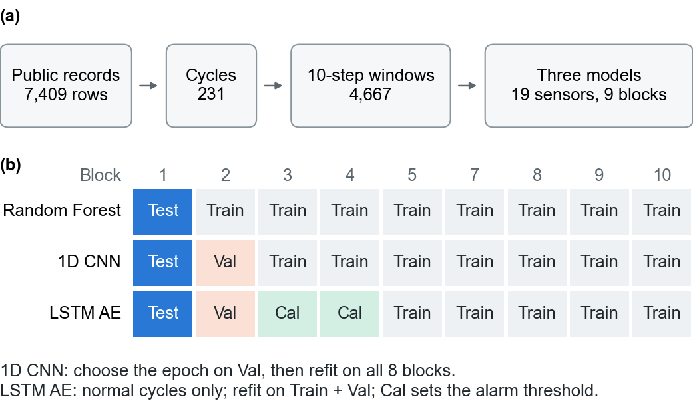
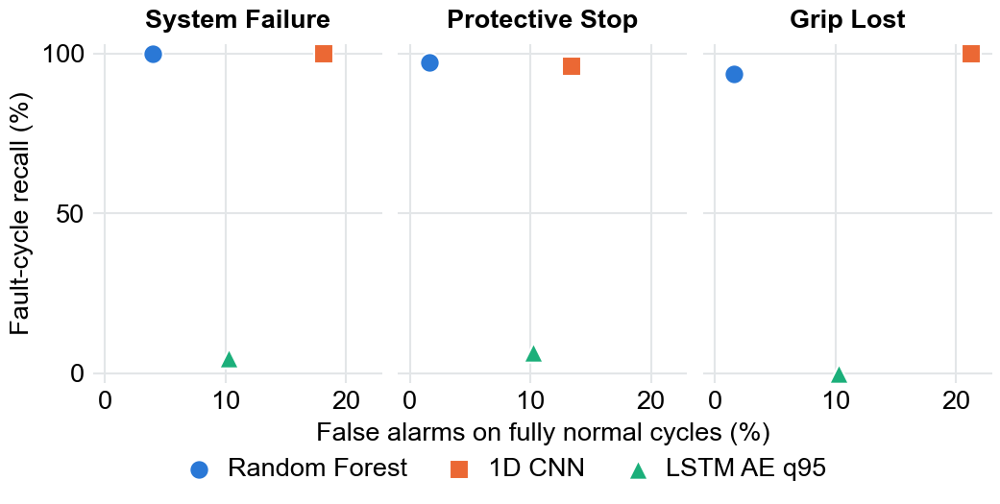

# UR3 CobotOps 로봇팔 센서 데이터 기반 이상탐지를 위한 시계열 맥락 반영 및 딥러닝 모델 비교 연구

남궁도현, 김택명

가톨릭대학교 인공지능학과

# Temporal Context and Deep Learning Model Comparison for Anomaly Detection in UR3 CobotOps Robot Arm Sensor Data

Dohyun Namgung, Taekmyung Kim

Department of Artificial Intelligence, The Catholic University of Korea

Abstract

An earlier course project classified UR3 CobotOps records from single time points under random row splits, which can place neighboring observations in both training and evaluation. We asked whether temporal context and deep learning improve detection when whole cycles and blocks of about 25 cycles are held out. Using 231 cycles, 4,667 overlapping 10-step windows, 19 sensors, and nine held-out blocks, we compared a Random Forest on window statistics, a 1D CNN on raw sequences, and an LSTM Autoencoder trained on normal data for System Failure, Protective Stop, and Grip Lost. For Grip Lost, the Random Forest and 1D CNN detected 45 and 48 of 48 fault cycles, with false alarms on 2 and 27 of 127 fully normal cycles. Under a prespecified cap of 40 epochs that left it underfit, the Autoencoder's recall was 0 to 6.58%; a post hoc rerun with 400 epochs improved detection but stayed below the Random Forest. Removing the joint and tool current sensors lowered Random Forest detection of Grip Lost from 45 to 26 of 48, though joint speed alone detected 46 with 28 false alarms. Window statistics detected more fault cycles than a row-level Random Forest in a post hoc comparison, and raw-sequence deep learning showed no added benefit over them at 10 steps. The blocks are not independent sessions: when the Random Forest was trained before the one long recording gap and tested after it, it detected 53 of 71, 7 of 63, and 0 of 25 fault cycles at its 0.50 threshold, with no false alarms on 56 fully normal cycles; the 1D CNN was not tested on this split. The results come from one robot's public data and describe detection of fault-containing windows, not early warning.

Key words: UR3 CobotOps, Multivariate time series, Anomaly detection, Cycle-aware split, Random Forest, 1D CNN, LSTM Autoencoder

## I. 서 론

협동로봇은 사람과 같은 공간에서 일할 수 있도록 힘과 출력을 제한하고 예상하지 못한 접촉이 있으면 바로 멈춘다. 이런 안전 기능 때문에 작업 중 보호 정지가 일어나기도 하고 힘이 제한된 상태에서 작업물을 놓치는 파지 상실이 생기기도 한다 [1]. UR3 CobotOps는 이 두 고장을 기록한 공개 데이터로, UR3 협동로봇이 물건을 집어 옮기는 작업에서 관절 전류, 온도, 속도와 그리퍼 전류를 저장하였다 [1,2].

이 데이터를 공개한 Tyrovolas 등은 두 고장 중 하나라도 있으면 고장으로 보는 System Failure를 정의하고, 정보 흐름 기반 퍼지 인지 지도(IF-FCM)와 기존 FCM을 SMOTE-ENN과 층화 10겹 교차검증으로 비교하였다 [1]. 저자들은 SMOTE-ENN과 K겹 분할의 한계를 직접 언급하면서도 시간 순서가 아니라 센서 패턴 분류에 초점을 두었으므로 효과적이었다고 보았다 [1]. Yaşar Çıklaçandır 등은 같은 데이터에서 고전 모델과 특징 선택을 비교하여 70:30 분할에서 특징 선택 전 랜덤 포레스트 정확도 0.9848(보호 정지)과 0.9898(파지 상실)을 보고하였다 [3]. Taş와 Bal은 보호 정지 분류에 BiRNN을 적용하면서 자료를 행 기준 무작위 80:20으로 나누었다 [4]. 두 연구 [3,4]에는 사이클이나 시간 구간을 통째로 떼어 둔 평가가 제시되어 있지 않다.

Shen 등은 70/15/15의 시간순 분할에서 Transformer와 ODE를 결합한 모델로 고장 분류와 잔여 수명(RUL) 예측을 함께 수행하였다 [5]. 본 연구와 가까운 방향이지만 고장 상태가 이어지는 구간을 따로 처리했는지와 사이클별 표준화가 미래 시점의 통계를 쓰는지는 본문만으로 확인할 수 없다. 대상은 다르지만, 고전적 디코더와 딥러닝 모델을 피험자를 한 명씩 제외하는 같은 평가(LOSO)로 비교한 Pinto Neto의 설계 [6]를 방법론의 참고로 삼았다. 이 설계는 모델 복잡도를 우위로 전제하지 않았다.

같은 데이터를 써도 분할 방식과 평가 단위가 달라지면 성능 수치로 답하는 질문도 달라진다. 개별 행을 무작위로 나누면 같은 사이클에서 시간상 가까운 관측값이 학습과 평가에 함께 들어갈 수 있다. 기존 머신러닝 수업 프로젝트도 한 시점의 센서값으로 고장 상태를 분류하였고 행 기준 무작위 80:20 분할에서 통합 고장의 Macro F1 0.80, ROC-AUC 0.94를 기록하였으나 이 문제에서 자유롭지 않았다. 그래서 본 연구에서는 사이클과 25사이클 블록을 통째로 떼어 평가하고 시간 순서를 직접 입력받는 딥러닝 모델이 기존 접근을 개선하는지 살펴보았다.

본 연구가 답하려는 질문은 개별 시점 중심의 기본 머신러닝 모델과 비교할 때, 시계열 맥락을 반영한 데이터 표현과 딥러닝 모델이 이상 상태 탐지 성능과 해석 가능성을 개선하는가이다. 연구계획서는 이 질문을 다음 다섯 하위 질문으로 나누었다. 첫째, 행 단위 입력과 비교해 시계열 구간 표현은 탐지 성능을 개선하는가. 둘째, 정상 데이터로 학습한 LSTM 오토인코더는 기본 머신러닝 모델 대비 어떤 장점과 한계를 보이는가. 셋째, 1D CNN은 센서 구간의 시간적 패턴을 탐지에 효과적으로 활용하는가. 넷째, 통합 라벨과 개별 고장 유형의 분석은 어떤 차이를 보이는가. 다섯째, 전류, 속도, 온도, 그리퍼 전류 중 어떤 센서 그룹이 고장 탐지와 더 밀접한가.

초기 시계열 비교에서 1D CNN은 많은 고장 사이클을 탐지했지만 해당 고장이 없는 사이클에서 랜덤 포레스트보다 자주 경보하였다. 그래서 경보를 완전 정상 사이클의 오경보와 다른 고장에 대한 교차 경보로 나누어 보고한다. 센서 그룹 제거 실험의 조건과 해석 규칙은 결과 확인 전에 고정하였다. 주 결과는 고장 상태가 포함된 구간의 탐지이며, 최초 양성 시점 이전의 기록만 쓰는 고장 전 예측은 별도의 탐색 분석으로 다룬다.

## II. 연구 방법

### 1. 연구 설계

연구 과정은 그림 1과 같다. 공개 기록을 사이클과 구간으로 나눈 뒤, 같은 19개 센서와 같은 9개 블록 분할에서 모델을 비교하였다(그림 1a). 블록을 하나씩 시험용으로 떼어 두고, 나머지 블록의 역할은 모델의 학습 방식에 따라 달리하였다(그림 1b).

그림 1. 연구 설계. (a) 공개 기록에서 모델 비교까지의 처리 (b) 시험 블록이 1번일 때 모델별 블록 역할의 예. 다른 블록을 시험용으로 둘 때도 같은 구조를 따른다
Fig. 1. Study design. (a) From public records to model comparison; (b) example of block roles by model when block 1 is the test block. The same structure applies when another block is held out.

연구계획서와 달라진 점은 다음과 같다. 행 단위 기준 모델은 랜덤 포레스트로만 재현했고, 로지스틱 회귀와 RBF SVM은 구간 통계 특징에서 비교하였다. 재구성 오차 기반 모델은 계획서의 LSTM/GRU 오토인코더 중 LSTM을 사용하였다. 랜덤 분할과 사이클 분할의 비교는 탐색 단계에서 한 번 수행하였다. 사이클 분할에서 랜덤 포레스트의 Macro F1은 통합 고장 0.8013→0.7901, 파지 상실 0.7988→0.7623으로 낮아졌지만 보호 정지는 0.7921→0.8428로 높아졌다. 이 비교는 분할마다 시험 행이 달라 방향을 말할 수 없으므로, 같은 데이터의 5겹 비교를 III장 7절에 따로 제시한다. 이후의 주 비교는 25사이클 블록 단위로 분할하였고, 고장 전 예측 부가 분석만 사이클 단위 반복 분할을 사용하였다(8절). 오탐·미탐 사례 분석은 개별 사례 대신 완전 정상 오경보와 교차 고장 경보의 건수로 정리하였다. 구간 수준의 혼동 행렬은 계산했으나 본문에는 사이클 단위 지표를 우선 제시하고, 구간 재현율과 정밀도는 III장 2절에 적는다.

### 2. 데이터와 탐지 대상

UCI Machine Learning Repository의 UR3 CobotOps 데이터 [2]를 사용하였다. UCI에 등록된 파일은 Excel 형식이고, 분석에는 같은 7,409행 24열에 수치 차이가 5e-8 미만인 CSV를 사용하였다. 모델 입력은 관절 J0~J5의 전류·온도·속도와 그리퍼 전류(Tool current)를 합친 원본 센서 19개이다. 탐지 대상은 보호 정지(Protective Stop), 파지 상실(Grip Lost), 둘 중 하나라도 있으면 양성인 통합 고장(System Failure)의 세 가지이며, 각각 별도의 이진 탐지 문제로 평가하였다.

자료를 살펴보고 네 가지를 평가 설계에 반영하였다. 첫째, 통합 고장 라벨은 양성 518행, 음성 6,837행, 결측 54행으로 양성이 적다. 전체 정확도만으로는 성능을 알기 어려우므로 Macro F1, PR-AUC, 고장 사이클 재현율을 함께 보고한다. 둘째, 863행은 타임스탬프가 큰따옴표로 한 번 더 감싸여 있었다. 초기 코드는 이 행들의 시각을 읽지 못해 사이클을 202개로 집계하였고, 이 오류는 사전 문서를 쓴 뒤에 발견하였다. 따옴표를 제거한 뒤 시각으로 변환해 모든 행을 같은 기준으로 정렬하고, 표에 쓴 분석을 같은 조건으로 다시 실행하였다. 본문에서 결과 확인 전에 고정했다는 것은 수정 전 결과를 보기 전이라는 뜻이고, 표의 값은 수정 후 재실행 결과이다. 셋째, 일부 사이클 번호는 시간상 떨어진 구간에서 다시 나타났다. 번호가 이어지는 구간마다 식별자(cycle_run)를 새로 붙였고, 최종 비교에 들어간 231개 구간을 이 논문에서는 사이클이라 부른다. 넷째, 양의 타임스탬프 간격의 중앙값은 1.005초였으나 긴 간격도 있었다. 그래서 입력 길이는 초가 아니라 저장된 관측값의 개수인 스텝(step)으로 적는다.

고장 사이클은 통합 고장 104개, 보호 정지 76개, 파지 상실 48개이다. 완전 정상 사이클은 모든 평가 구간에서 통합 고장 라벨이 0인 사이클로 정의하였고 127개이다.

### 3. 구간과 라벨

사이클 안에서 10스텝 구간을 한 칸씩 옮겨 가며 만들었다. 구간은 사이클 경계를 넘지 않는다. 구간은 모두 4,667개지만 서로 겹치므로 독립 표본 수로 보지 않는다. 구간의 라벨은 구간 안에 있는 라벨의 최댓값이다. 따라서 양성 구간은 고장이 일어난 시점을 포함할 수 있고, 주 결과는 고장 예측이 아니라 고장이 든 구간의 탐지이다.

행 단위 기준 모델과의 초기 비교에서는 5, 10, 20스텝을 탐색하였다. 그 결과를 본 뒤, 딥러닝 비교 전에 10스텝을 공통 입력으로 고정하였다. 이 길이는 물리적 근거로 정한 값이 아니므로, 주 모델을 5스텝과 20스텝으로 다시 학습해 III장 7절에서 점검하였다. RTDE 인터페이스의 125 Hz [1]와 분석 파일의 실제 저장 간격이 같지 않으므로, 10스텝은 약 10초라고 단정하지 않고 저장된 관측값 10개로 해석한다.

### 4. 분할과 누수 통제

Tyrovolas 등은 작업물 하중, 동작 속도, 파지력을 달리한 시험 시나리오마다 25회 반복했다고 기술하였다 [1]. 반복 1회가 사이클 번호 1개에 해당하는지, 같은 시나리오가 이어서 수집되었는지는 밝히지 않았다. 여기서는 이를 가정해 사이클 번호를 25개씩 묶어 블록을 만들고, 사이클이 20개 미만인 6번(4개)과 11번(14개)을 제외한 1, 2, 3, 4, 5, 7, 8, 9, 10번 블록을 사용하였다. 시간상 떨어져 다시 나타난 사이클 번호 224~233(228 제외)은 원래 번호대로 9번과 10번 블록에 넣었다. 각 블록을 한 번씩 시험 블록으로 두고, 나머지 8개를 모델별 학습, 검증, 임계값 보정에 사용하였다. 표준화, SMOTE, 에폭 선택, 임계값 보정은 모두 시험 블록 밖에서 수행하였다.

블록은 실제 공정조건의 정답도, 독립된 수집 세션도 아니다. 공개 파일에는 사이클별 조건 대응표가 없다. 기록은 모두 2022-10-26 하루의 것이고 블록이 바뀌는 지점의 시간 간격은 최대 2.0초여서, 블록은 이어진 기록을 사이클 번호로 자른 근사 단위이다. 긴 공백은 사이클 105 안의 5.2시간 한 번이고 그 밖의 간격은 최대 31초이며, 평균 관절 온도는 1번 블록 32.1도에서 10번 블록 41.9도로 올랐다. 블록에는 이런 시간 변화가 함께 들어 있으므로 평가 결과는 같은 데이터 안의 내부 일반화로 제한하고, 공백 전후로 나눈 시간순 점검을 III장 7절에 제시한다.

### 5. 비교 모델

랜덤 포레스트는 19개 센서마다 평균, 표준편차, 최솟값, 최댓값, 범위, 첫값과 끝값의 차이, 기울기를 계산한 133개 특징을 입력받는다. 학습 블록에만 SMOTE를 적용한 뒤 트리 300개로 학습하였고, random_state 42를 사용하였다. 점수가 0.50을 넘으면 경보로 판정하였다.

1D CNN은 시계열 분류에 쓰이는 구조 [7]로, 10×19 원시 구간을 그대로 입력받는다. Conv1D 19→32, Conv1D 32→64, 전역 평균 풀링, 드롭아웃 0.2, 선형 출력층으로 구성하였다. 클래스 가중 이진 교차 엔트로피, Adam, 학습률 1e-3, 가중치 감쇠 1e-4를 사용하였다. 학습 블록 중 1개로 에폭을 정한 뒤 8개 블록 전체로 다시 학습하였다. 랜덤 포레스트와 같이 점수가 0.50을 넘으면 경보로 판정하였다.

LSTM [8] 오토인코더는 정상 구간을 복원하도록 학습하고 복원 오차로 이상을 판정한다 [9]. 단층 LSTM 인코더와 디코더의 은닉 크기는 각각 32이고 19개 센서를 복원한다. 분할마다 시험 1개, 검증 1개, 임계값 보정 2개, 초기 학습 5개 블록으로 나누었다. 초기 학습 블록의 완전 정상 사이클로 학습하고 검증 블록의 완전 정상 사이클로 에폭을 고른 뒤, 두 집합을 합친 6개 블록의 완전 정상 사이클로 다시 학습하였다. 보정용 2개 블록은 학습, 에폭 선택, 최종 표준화 계수 산출에서 제외하였다.

구간의 이상 점수는 표준화한 10개 시점과 19개 센서의 재구성 평균제곱오차이다. 보정 블록의 완전 정상 사이클마다 구간 점수의 최댓값을 구하고, 분할과 시드별로 이 최댓값 분포의 경험적 95백분위수를 주 임계값 q95로 정하였다(numpy.quantile, method=higher). 시험 구간의 점수가 임계값을 엄격히 넘으면 경보로 판정하였다. 같은 분할과 시드의 점수와 임계값을 세 탐지 대상에 공통으로 썼고, q90과 q97.5는 민감도 분석에 썼다.

1D CNN과 LSTM 오토인코더는 시드 42, 43, 44로 반복하였고, 에폭 상한은 사전 문서대로 40이다. 세 시드 중 둘 이상이 경보한 사이클을 경보 사이클로 집계하였고, 둘 이상의 시드가 각각 실제 양성 구간에서 한 번 이상 경보한 경우를 탐지로 집계하였다. 랜덤 포레스트는 시드 42의 고정 결과를 사용하였다.

고전 모델끼리의 통제 비교로 같은 133개 특징에 로지스틱 회귀와 RBF SVM을 적용하였다. 학습 분할 안에서 StandardScaler와 SMOTE를 쓰고, 로지스틱 회귀는 L2, C=1, solver=saga를, RBF SVM은 C=1, gamma=scale을 사용하였다. 결과를 확인한 뒤 격자 탐색이나 판정 기준 조정은 추가하지 않았다.

### 6. 센서 그룹 제거 실험

랜덤 포레스트의 학습과 평가 조건을 유지하면서 입력 센서 그룹만 바꾸었다. 그룹은 관절 전류 6개, 관절 온도 6개, 관절 속도 6개, 그리퍼 전류 1개이고, 관절 전류와 그리퍼 전류를 합친 7개를 전류 계열이라 부른다. 전체 19개를 기준선으로, 한 그룹만 쓰는 단독 조건 5개와 한 그룹을 빼는 제거 조건 4개를 비교하였다.

비교 조건과 해석 규칙은 결과 확인 전에 고정하였다. 제거 조건에서 탐지가 줄거나 같고 오경보가 늘거나 같으며 둘 중 하나가 나빠지면, 그 그룹이 현재 모델에 기여했다는 기술적 근거로 본다. 두 지표의 방향이 엇갈리면 상충(trade-off)으로 기록하고 어느 쪽이 낫다고 주장하지 않는다. 단독 조건은 기준선과의 차이만 보고하며 충분 여부를 판정하지 않는다. 센서 그룹이 바뀌면 입력 차원과 SMOTE가 적용되는 특징 공간도 함께 달라진다.

### 7. 평가 지표

사이클 수준의 주 지표는 세 가지이다. 고장 사이클 재현율은 실제 양성 구간이 있는 사이클 중 그 양성 구간에서 경보한 사이클의 비율이다. 완전 정상 오경보율은 어떤 고장도 없는 사이클에서 경보가 발생한 비율이고, 교차 고장 경보율은 해당 고장은 없지만 다른 고장만 발생한 사이클에서 경보가 발생한 비율이다. 표에는 비율과 함께 건수와 분모를 적었다. 사이클 안에서 양성 구간 하나만 경보해도 탐지로 세므로, 이 재현율은 고장 구간을 모두 맞혔다는 뜻이 아니다. 사이클 비율에는 Wilson 95% 신뢰구간을 계산하였다.

구간 수준에서는 Accuracy, Macro F1, 양성 클래스의 정밀도·재현율·F1, ROC-AUC, PR-AUC를 계산하였다. Macro F1은 고정 판정 기준에서 두 클래스의 F1을 같은 비중으로 평균한 값이다. PR-AUC(평균 정밀도)는 양성 구간의 점수 순위를 정밀도와 재현율로 요약하고, ROC-AUC는 양성과 음성을 얼마나 잘 구분하는지 보조로 제시한다. 블록은 같은 로봇 기록에서 나눈 평가 단위이므로 결과는 이 데이터 안의 기술적 비교로 해석한다.

### 8. 고장 전 예측 부가 분석

주 분석과 별개의 탐색으로, 최초 양성 시점 이전에 끝나는 구간만 사용하였다. 구간이 끝난 시점에서 최초 양성까지 남은 스텝이 예측 범위 안이면 양성, 그 밖의 구간과 고장이 없는 사이클의 구간은 음성이다. 설정(구간 길이/예측 범위)은 초기 단일 분할 탐색에서 고른 뒤 고정한 통합 고장 5/10, 보호 정지 10/3, 파지 상실 5/3스텝이다. 입력은 파생 변수를 포함한 26개이고 SMOTE와 트리 300개의 랜덤 포레스트를 사용하였다. 9개 블록이 아니라 전체 사이클을 사이클 단위로 80:20 나누었고, 학습과 시험에 양성이 모두 있는 분할 30회를 반복하였다. 설정을 고를 때 쓴 사이클이 반복 분할에도 들어가므로 결과는 다소 낙관적일 수 있다. 경보 규칙의 기준선으로 모든 구간을 양성으로 예측할 때의 F1을 함께 제시한다.

## III. 연구 결과

### 1. 행 단위와 구간 단위의 초기 비교

세 탐지 대상 모두 구간 통계 특징의 Macro F1과 PR-AUC가 행 단위 기준 모델보다 높았다(표 1). PR-AUC는 통합 고장 0.6430에서 0.8927로, 보호 정지 0.7409에서 0.8796으로, 파지 상실 0.5604에서 0.7831로 올랐다. 그러나 이 차이를 시계열 맥락의 효과로 읽을 수는 없다. PR-AUC의 우연 수준은 양성 비율인데, 양성 비율이 행과 구간에서 크게 다르다(통합 고장 7.0%와 44.9%). 평가 단위, 라벨, 분할도 같지 않고, 구간 길이는 같은 시험 분할에서 골랐다. 같은 구간과 라벨로 평가한 입력 비교는 7절에 따로 제시한다. 이후의 모델 비교는 10스텝으로 고정한 결과이다.

표 1. 탐지 대상별 구간 설정의 초기 탐색 결과
Table 1. Initial search results for window settings by target

| Target | Row Macro F1 | Best window | Window Macro F1 | Row PR-AUC | Window PR-AUC | Row positive % | Window positive % |
|---|---|---|---|---|---|---|---|
| System Failure | 0.7901 | 20-step | 0.8860 | 0.6430 | 0.8927 | 7.0 | 44.9 |
| Protective Stop | 0.8428 | 5-step | 0.8776 | 0.7409 | 0.8796 | 3.8 | 10.2 |
| Grip Lost | 0.7623 | 10-step | 0.8244 | 0.5604 | 0.7831 | 3.3 | 11.2 |

Best window has the highest PR-AUC on the same test split. Row models use one 80:20 split grouped by original cycle ID; window models use one 80:20 split grouped by cycle run. Both use 26 inputs, the 19 sensors plus 7 derived values, unlike the 19 inputs of the main comparison. Positive %, share of positive rows or windows in the data.

### 2. 주 모델 비교

고장 탐지 수는 랜덤 포레스트와 1D CNN이 비슷했고, 차이는 경보 부담에서 나타났다(표 2, 그림 2). 통합 고장에서는 두 모델 모두 104/104개를 탐지하였다. 보호 정지는 각각 74/76과 73/76, 파지 상실은 45/48과 48/48이었다. 반면 파지 상실의 완전 정상 오경보는 랜덤 포레스트 2/127, 1D CNN 27/127이었고, 다른 고장만 발생한 사이클의 경보는 3/56과 22/56이었다. 1D CNN이 파지 상실을 모두 찾은 대신 완전 정상 사이클 다섯 개 중 한 개꼴로 경보했다는 뜻이다.

표 2. 주 모델별 고장 사이클 탐지와 경보 건수
Table 2. Fault-cycle detection and alert counts by main model

| Target | Model | Detected / fault cycles | False alarms / fully normal cycles | Cross-fault alerts / other-fault cycles |
|---|---|---|---|---|
| System Failure | Random Forest | 104/104 (100.00%) | 5/127 (3.94%) | n/a |
|  | 1D CNN | 104/104 (100.00%) | 23/127 (18.11%) | n/a |
|  | LSTM AE q95 | 5/104 (4.81%) | 13/127 (10.24%) | n/a |
| Protective Stop | Random Forest | 74/76 (97.37%) | 2/127 (1.57%) | 0/28 (0.00%) |
|  | 1D CNN | 73/76 (96.05%) | 17/127 (13.39%) | 4/28 (14.29%) |
|  | LSTM AE q95 | 5/76 (6.58%) | 13/127 (10.24%) | 0/28 (0.00%) |
| Grip Lost | Random Forest | 45/48 (93.75%) | 2/127 (1.57%) | 3/56 (5.36%) |
|  | 1D CNN | 48/48 (100.00%) | 27/127 (21.26%) | 22/56 (39.29%) |
|  | LSTM AE q95 | 0/48 (0.00%) | 13/127 (10.24%) | 6/56 (10.71%) |

Fully normal cycles have no fault label in any evaluated window. System Failure is the union of the two faults, so it has no other-fault category. AE, Autoencoder, trained under the prespecified cap of 40 epochs (see Section IV); q95, main threshold defined in Section II.5; n/a, not applicable.

몇 건 차이의 탐지 수는 우열로 해석하지 않는다. 파지 상실 탐지율의 Wilson 95% 구간은 랜덤 포레스트 83.2~97.9%, 1D CNN 92.6~100.0%로 겹친다. 반면 완전 정상 오경보율의 구간은 0.4~5.6%와 15.0~29.2%로 겹치지 않았다. 이 구간은 같은 블록 안 사이클 사이의 상관을 반영하지 않으므로 실제 불확실성은 더 클 수 있다. LSTM 오토인코더의 q95 탐지는 세 탐지 대상에서 5/104, 5/76, 0/48로 매우 적었다. 이 값은 사전에 정한 에폭 상한의 결과이며 해석은 IV장에서 다룬다.

표 2의 100%는 이 블록 평가에서 고장 사이클마다 양성 구간 하나 이상을 경보했다는 뜻이며, 모든 고장 구간을 맞혔다거나 운용 성능이 그렇다는 뜻이 아니다. 0.50 기준의 구간 재현율은 랜덤 포레스트 75.2%, 79.9%, 53.6%, 1D CNN 77.3%, 82.8%, 74.2%이고, 구간 정밀도는 랜덤 포레스트 78.9%, 81.2%, 87.8%, 1D CNN 63.1%, 56.6%, 48.5%이다(순서는 통합 고장, 보호 정지, 파지 상실). 시간순으로 나누었을 때의 결과는 III장 7절에 제시한다.

그림 2. 고장 사이클 재현율과 완전 정상 사이클 오경보율. 왼쪽 위에 가까울수록 오경보가 적고 재현율이 높다. 값은 표 2와 같고, 교차 고장 경보는 표 2에 제시하였다
Fig. 2. Fault-cycle recall and false-alarm rate on fully normal cycles. Points nearer the upper left have fewer false alarms and higher recall. Values match Table 2, which also lists cross-fault alerts.

구간 수준의 보조 지표에서도 세 탐지 대상 모두 랜덤 포레스트가 가장 높았다(표 3). 파지 상실에서 랜덤 포레스트와 1D CNN의 Macro F1은 0.8159와 0.7580, PR-AUC는 0.7742와 0.6675, ROC-AUC는 0.9267과 0.9089였다. Macro F1은 각 모델의 고정 판정 기준으로, PR-AUC와 ROC-AUC는 판정 전 점수로 계산하였다. 표 2의 사이클 결과와는 평가 단위와 집계 방식이 다르다.

표 3. 주 모델의 구간 수준 보조 지표
Table 3. Window-level supporting metrics of the main models

| Target | Model | Macro F1 | PR-AUC | ROC-AUC |
|---|---|---|---|---|
| System Failure | Random Forest | 0.8482 | 0.8515 | 0.9288 |
|  | 1D CNN | 0.7888 | 0.7334 | 0.8827 |
|  | LSTM AE q95 | 0.4391 | 0.2237 | 0.4202 |
| Protective Stop | Random Forest | 0.8871 | 0.8706 | 0.9651 |
|  | 1D CNN | 0.8021 | 0.7877 | 0.9261 |
|  | LSTM AE q95 | 0.4821 | 0.1592 | 0.4599 |
| Grip Lost | Random Forest | 0.8159 | 0.7742 | 0.9267 |
|  | 1D CNN | 0.7580 | 0.6675 | 0.9089 |
|  | LSTM AE q95 | 0.4658 | 0.0866 | 0.3934 |

Predictions for the 4,667 windows from the nine test blocks are pooled per seed. The Random Forest uses one fixed seed; deep-model values are means over three seeds. The Autoencoder was trained under the prespecified cap of 40 epochs.

### 3. 고전 모델 통제 비교

같은 통계 특징에서 로지스틱 회귀는 탐지가 높았지만 경보가 많았고, RBF SVM은 경보를 줄였으나 탐지 대상별 상충이 남았다(표 4). 로지스틱 회귀의 완전 정상 오경보율은 26.77%에서 47.24%였다. RBF SVM은 보호 정지에서 이 값이 0.00%였지만 파지 상실의 교차 고장 경보율은 30.36%였다. 통계 특징에는 선형 모델과 커널 모델도 활용할 수 있는 신호가 있으나, 현재 조건에서는 랜덤 포레스트가 탐지와 경보 부담의 균형이 가장 안정적이었다.

표 4. 같은 통계 특징에서의 고전 모델 비교
Table 4. Classical models on the same window statistics

| Target | Model | Fault recall | False-alarm rate on fully normal cycles | Cross-fault alert rate |
|---|---|---|---|---|
| System Failure | Random Forest | 100.00% | 3.94% | n/a |
|  | Logistic Regression | 99.04% | 45.67% | n/a |
|  | RBF SVM | 99.04% | 7.87% | n/a |
| Protective Stop | Random Forest | 97.37% | 1.57% | 0.00% |
|  | Logistic Regression | 97.37% | 26.77% | 28.57% |
|  | RBF SVM | 96.05% | 0.00% | 3.57% |
| Grip Lost | Random Forest | 93.75% | 1.57% | 5.36% |
|  | Logistic Regression | 100.00% | 47.24% | 69.64% |
|  | RBF SVM | 95.83% | 9.45% | 30.36% |

All models use the same 133 window statistics. n/a, not applicable.

### 4. 센서 그룹 제거 실험

전류 계열을 빼면 파지 상실의 탐지가 가장 크게 달라졌다(표 5). 탐지가 45/48에서 26/48로 줄었고 완전 정상 오경보는 2/127에서 1/127로 한 건 적어져, 사전 규칙에 따라 상충으로 기록한다. 규칙상 상충이지만 탐지 감소(19건)가 오경보 감소(1건)보다 훨씬 크다. 전류 계열이나 관절 전류만으로도 45/48을 탐지해 기준선과 같았지만, 완전 정상 오경보(5/127, 10/127)와 교차 경보(14/56)는 기준선(2/127, 3/56)보다 많았다. 온도만 쓰면 1/48만 탐지했고, 속도만 쓰면 46/48을 탐지했지만 완전 정상 오경보가 28/127이었다. 따라서 전류 계열이 0.50 기준의 탐지와 오경보 균형에 기여했다고 볼 수는 있어도, 파지 상실의 신호가 전류 계열에만 있다고 볼 수는 없다.

통합 고장과 보호 정지는 전류 계열을 빼도 탐지가 101/104와 75/76으로 크게 줄지 않았고, 완전 정상 오경보가 각각 5/127에서 11/127, 2/127에서 5/127로 늘었다. 보호 정지의 교차 경보도 0/28에서 4/28로 늘었다. 사전 규칙으로 보면 통합 고장은 전류 계열이 기여한 근거에 해당하고, 보호 정지는 탐지가 한 건 늘어 상충에 해당한다. 전류 계열을 뺐을 때 파지 상실에서는 탐지가, 나머지 둘에서는 오경보가 주로 달라진 것이다.

그리퍼 전류만 쓴 조건은 세 탐지 대상에서 완전 정상 사이클의 69~87%에 경보하였다. 그리퍼 전류는 이상이 생긴 뒤 변할 수 있으므로 구간 탐지에서의 유용성을 고장 전조로 해석하지 않는다. 온도도 기록 시간에 따른 변화를 반영할 수 있어 단독 성능을 고장 메커니즘으로 해석하지 않는다. 관절 전류만 빼고 그리퍼 전류를 유지한 조건은 사전 목록에 없으므로, 관절 전류 제거의 효과는 따로 말할 수 없다.

표 5. 센서 그룹 조건별 랜덤 포레스트의 탐지와 경보 건수
Table 5. Random Forest detection and alert counts by sensor-group condition

| Condition | n | SF Det. /104 | SF FA /127 | PS Det. /76 | PS FA /127 | PS Cross /28 | GL Det. /48 | GL FA /127 | GL Cross /56 |
|---|---|---|---|---|---|---|---|---|---|
| All sensors (baseline) | 19 | 104 | 5 | 74 | 2 | 0 | 45 | 2 | 3 |
| Current family only | 7 | 102 | 6 | 73 | 7 | 2 | 45 | 5 | 14 |
| Joint current only | 6 | 103 | 7 | 73 | 7 | 2 | 45 | 10 | 14 |
| Tool current only | 1 | 80 | 111 | 58 | 88 | 21 | 31 | 93 | 47 |
| Joint speed only | 6 | 102 | 30 | 75 | 9 | 8 | 46 | 28 | 23 |
| Joint temperature only | 6 | 24 | 14 | 10 | 7 | 2 | 1 | 0 | 1 |
| Drop current family | 12 | 101 | 11 | 75 | 5 | 4 | 26 | 1 | 3 |
| Drop joint speed | 13 | 102 | 5 | 72 | 3 | 0 | 44 | 3 | 6 |
| Drop joint temperature | 13 | 104 | 8 | 74 | 7 | 5 | 45 | 4 | 6 |
| Drop tool current | 18 | 104 | 6 | 74 | 3 | 2 | 45 | 1 | 5 |

n, number of sensors; SF, System Failure; PS, Protective Stop; GL, Grip Lost; Det., detected fault cycles; FA, false alarms on fully normal cycles; Cross, alerts on cycles with only the other fault (PS, Grip Lost only; GL, Protective Stop only). Shaded columns are detections; the others are alerts. Current family is joint current plus tool current. The ten conditions were fixed before the results were seen.

### 5. 고장 전 예측 부가 분석

최초 양성 이전 구간만 쓴 30회 반복 분할에서 양성 F1 평균은 통합 고장 0.1178, 보호 정지 0.1344, 파지 상실 0.3758이었다. 같은 시험 분할의 양성 비율은 7.62%, 1.06%, 1.86%이고, 모든 구간을 양성으로 예측할 때의 F1은 0.1416, 0.0209, 0.0365이다. 통합 고장의 F1은 이 기준선보다 낮아 0.50 기준의 경보가 전부 양성 예측보다 낫지 않았다. 다만 PR-AUC 0.2389, ROC-AUC 0.7998로 순위 정보는 일부 있었다. 보호 정지는 30회 중 6회에서만 양성을 하나 이상 탐지했고, 시험 양성 구간이 회당 3~12개로 적어 평균값의 불확실성이 크다. 전체 자료에서 보호 정지가 있는 사이클 85개 중 최초 양성 이전에 10스텝 구간을 만들 수 있는 사이클은 6개뿐이어서, 이 결과는 소수의 사이클에 기댄 값이다. 파지 상실은 30회 모두에서 양성을 하나 이상 탐지했고 F1이 기준선의 약 10배였지만 평균 재현율은 0.2814였다. 약한 사전 신호가 있을 가능성은 남지만 실용적인 조기 경보 성능을 확보했다고 볼 수는 없다.

### 6. 공정조건 역추적

공정조건을 사이클에 다시 연결하지는 못하였다. Tyrovolas 등에는 작업물 하중 1, 2, 3 kg, 동작 속도 60, 80, 100%, 파지력 80, 100, 120 N과 시험 시나리오당 25회 반복이 기술되어 있다 [1]. 그러나 공개 자료에는 사이클별 조건표가 없고 가능한 27개 조합의 사용 여부와 수집 순서도 제시되지 않았다. 반복 1회가 사이클 번호 1개라면 27개 조합 전체는 675개여야 하지만 사이클 번호의 최댓값은 264이다. 센서 기반 군집화는 세 조건이 각각 세 수준으로 구분된다는 근거를 주지 못했고, 25사이클 후보 블록은 공정 센서보다 온도만으로 더 잘 구분되었다. 이 결과는 본 연구의 성과가 아니라 데이터 출처의 한계와 시간 변화 가능성을 확인한 점검 결과로 해석한다.

### 7. 사후 점검

이 절의 분석은 사전 문서에 없던 것으로 결과를 본 뒤 추가하였고, 주 결과를 대체하지 않는다.

**단일 시점 입력과의 통제 비교.** 같은 4,667개 구간과 구간 라벨, 9개 블록으로 평가하고 SMOTE와 트리 300개를 유지해 세 입력을 비교하였다(표 6). 마지막 시점 모델은 구간의 마지막 행 19개 값을 쓴다. 양성 구간 중 마지막 행도 양성인 비율은 통합 고장 23.0%, 보호 정지 11.3%, 파지 상실 36.6%뿐이어서 이 입력은 고장 행을 보지 못하는 경우가 많다. 행 최댓값 모델은 행 라벨로 학습한 뒤 구간의 10개 행 점수 중 최댓값을 구간 점수로 쓴다. 고장 행을 볼 수 있지만 구간 특징은 없으므로 구간 통계가 더하는 부분을 보여 준다. 다만 평가 구간과 라벨은 같아도 학습 목표가 다르므로 입력 표현만의 효과로 해석하지 않는다. 구간 통계는 행 최댓값 모델보다 탐지가 6건, 5건, 6건 많았다. 완전 정상 오경보는 통합 고장(5/127과 11/127)과 파지 상실(2/127과 6/127)에서 적었고 보호 정지(2/127과 1/127)에서 한 건 많았다. 시드 42 한 번의 사후 비교이고 차이가 몇 건 수준이므로 구간 표현의 이점을 뒷받침하는 탐색 근거로만 해석한다.

표 6. 같은 구간과 라벨로 평가한 랜덤 포레스트 입력 비교(사후)
Table 6. Random Forest inputs evaluated on the same windows and labels (post hoc)

| Target | Input | Detected | False alarms | Cross-fault alerts | Macro F1 | PR-AUC |
|---|---|---|---|---|---|---|
| System Failure | Last step | 92/104 | 21/127 | n/a | 0.7132 | 0.5889 |
|  | Row maximum | 98/104 | 11/127 | n/a | 0.8317 | 0.8053 |
|  | Window statistics | 104/104 | 5/127 | n/a | 0.8482 | 0.8515 |
| Protective Stop | Last step | 70/76 | 15/127 | 4/28 | 0.7939 | 0.6560 |
|  | Row maximum | 69/76 | 1/127 | 2/28 | 0.8856 | 0.8380 |
|  | Window statistics | 74/76 | 2/127 | 0/28 | 0.8871 | 0.8706 |
| Grip Lost | Last step | 32/48 | 24/127 | 12/56 | 0.6124 | 0.3708 |
|  | Row maximum | 39/48 | 6/127 | 2/56 | 0.7699 | 0.6473 |
|  | Window statistics | 45/48 | 2/127 | 3/56 | 0.8159 | 0.7742 |

Seed 42. Last step, the last row of a window; Row maximum, a row-level model whose window score is the highest of its ten row scores; Window statistics, the main Random Forest. Macro F1 and PR-AUC are window level. n/a, not applicable.

**랜덤 포레스트 시드.** 시드 43, 44를 더해 세 시드 중 둘 이상 합의로 집계해도 탐지는 104/104, 74/76, 45/48로 같았다. 완전 정상 오경보는 4/127, 2/127, 1/127, 교차 경보는 보호 정지 1/28, 파지 상실 3/56으로 시드 42와 최대 1건 달랐다. 표 2~5는 사전에 정한 대로 시드 42 결과를 유지한다.

**같은 오경보 수준의 비교.** SMOTE를 쓴 랜덤 포레스트와 클래스 가중 1D CNN에서 0.50의 의미는 같지 않다. 시험 점수로 그린 사이클 곡선에서 1D CNN의 완전 정상 오경보를 랜덤 포레스트와 같게 맞추면(5건, 2건, 2건) 1D CNN의 탐지는 101/104, 68/76, 37/48로 랜덤 포레스트의 104/104, 74/76, 45/48보다 적었다. 고장과 완전 정상을 가르는 사이클 AUC는 랜덤 포레스트 0.9976, 0.9988, 0.9965, 1D CNN 0.9951, 0.9747, 0.9788이었다. 시험 점수로 맞춘 곡선 위의 한 점이므로 조정된 성능으로 쓰지 않는다. 같은 완전 정상 사이클에서 랜덤 포레스트만 경보한 수와 1D CNN만 경보한 수는 3과 21, 2와 17, 1과 26이었다(정확 McNemar p<0.001). 이 검정은 블록 안 사이클 사이의 상관을 반영하지 않는다.

**블록 구성.** 고장은 블록에 고르게 퍼져 있지 않다(표 7). 보호 정지 76개 중 41개가 9번과 10번 블록에 있다. 블록별 재현율의 최솟값은 랜덤 포레스트 100%, 50.0%, 66.7%, 1D CNN 100%, 50.0%, 100%였고, 블록별 완전 정상 오경보율의 최댓값은 랜덤 포레스트 11.1%, 11.1%, 9.1%, 1D CNN 71.4%, 57.1%, 72.7%였다. 보호 정지가 특정 블록에 몰려 있고 블록은 온도로 잘 구분되므로(6절), 온도로 보호 정지를 맞혔을 가능성도 점검하였다. 온도를 빼도 보호 정지 탐지는 74/76으로 같고 온도만으로는 10/76이어서, 블록 평가 안에서는 탐지가 온도에 기댔다는 근거가 보이지 않았다. 다만 온도를 빼면 완전 정상 오경보가 2/127에서 7/127로 늘었고(표 5), 아래 시간순 점검에서는 온도의 영향이 크게 나타났다.

표 7. 25사이클 블록별 사이클 구성
Table 7. Cycle composition of the 25-cycle blocks

| Block | Cycles | Fully normal | System Failure | Protective Stop | Grip Lost |
|---|---|---|---|---|---|
| 1 | 25 | 18 | 7 | 2 | 5 |
| 2 | 25 | 20 | 5 | 2 | 3 |
| 3 | 24 | 18 | 6 | 3 | 5 |
| 4 | 25 | 12 | 13 | 5 | 9 |
| 5 | 25 | 19 | 6 | 5 | 1 |
| 7 | 25 | 16 | 9 | 8 | 4 |
| 8 | 24 | 11 | 13 | 10 | 9 |
| 9 | 27 | 6 | 21 | 18 | 6 |
| 10 | 31 | 7 | 24 | 23 | 6 |
| Total | 231 | 127 | 104 | 76 | 48 |

Blocks group cycle IDs by 25; they are neither recording sessions nor process conditions. Blocks 6 and 11 are excluded for having fewer than 20 cycles. Blocks 3 and 8 lack cycle IDs 74 and 187. Blocks 9 and 10 add the second runs of IDs 224–225 and 226–233 (except 228), and block 10 lacks ID 244.

**시간순 점검.** 블록 평가는 시험 블록의 앞뒤 기록을 모두 학습에 쓴다. 그래서 5.2시간 공백 앞의 사이클 103개로 학습하고 공백 뒤의 사이클로 평가해 보았다(공백이 든 사이클 제외, 랜덤 포레스트 시드 42). 0.50 기준의 탐지는 53/71, 7/63, 0/25로 크게 줄었고 완전 정상 오경보는 0/56이었다. 점수의 순위는 남아 사이클 AUC는 0.9935, 0.9984, 0.9832였지만, 0.50 기준은 유지되지 않았다. 온도를 빼고 같은 분할로 다시 학습하면 탐지는 70/71, 55/63, 22/25, 완전 정상 오경보는 2/56, 0/56, 5/56이었다. 앞쪽 학습 자료에 고장 사이클이 적었고(보호 정지 13개, 파지 상실 22개) 공백 뒤로 온도가 높아진 점이 함께 작용했을 수 있으나, 분할이 하나뿐이어서 원인을 가를 수는 없다. 따라서 표 2의 탐지율은 블록 평가 조건의 값이다. 이 점검은 랜덤 포레스트만 대상으로 하였으므로, 시간순 조건에서 1D CNN과의 순서는 말하지 않는다.

**사이클 길이 기준선.** 모델 없이 사이클의 행 수만으로 판정해 보았다. 보호 정지 사이클의 행 수 중앙값은 32.5개로 완전 정상의 24개보다 많았고, 27행 이상을 경보로 하면 탐지 76/76, 완전 정상 오경보 1/127, 교차 경보 6/28이었다(사이클 AUC 0.9938). 기준을 시험 블록 밖에서 골라도 같았다. 같은 규칙으로 통합 고장은 82/104, 파지 상실은 26/48이어서 랜덤 포레스트보다 적었다. 행 수는 사이클이 끝나야 알 수 있으므로 같은 조건의 경쟁 모델은 아니지만, 보호 정지의 높은 탐지율을 어려운 판별의 증거로 볼 수는 없다. 랜덤 포레스트의 첫 경보 구간이 끝나는 행도 첫 보호 정지 행보다 중앙값 5행 뒤였고 74개 사이클 중 고장 행보다 앞선 경보는 없어, 이 탐지는 이미 일어난 정지를 확인하는 데 가깝다.

**분할 방식 비교.** II장 1절의 탐색 비교는 시험 행이 달랐으므로, 같은 자료를 5겹으로 나눈 랜덤 분할과 사이클 분할을 랜덤 포레스트로 비교하였다. 사이클 분할에서 Macro F1은 행 입력의 통합 고장 0.7870→0.7239, 보호 정지 0.8169→0.7648, 파지 상실 0.7562→0.6843, 구간 통계의 통합 고장 0.9459→0.8500, 보호 정지 0.9609→0.8918, 파지 상실 0.9405→0.8157로 모두 낮아졌다. 구간은 서로 겹치므로 랜덤 분할에서 차이가 특히 컸다. 사이클을 통째로 떼어 평가한 근거이다.

**구간 길이 민감도.** 구간 길이만 5스텝과 20스텝으로 바꾸고 나머지 조건은 유지해 랜덤 포레스트와 1D CNN을 다시 학습하였다(표 8). 길이마다 양성 비율이 달라 사이클 지표만 비교한다. 랜덤 포레스트는 길이가 달라져도 탐지가 102~104건, 70~74건, 43~46건, 완전 정상 오경보가 5~9건, 2~7건, 1~2건으로 변화가 작았다. 1D CNN은 5, 10, 20스텝에서 오경보가 56→23→7건, 25→17→12건, 88→27→6건으로 크게 줄었고 탐지도 103→104→82건, 74→73→65건, 48→48→46건으로 줄었다. 20스텝의 통합 고장 오경보는 1D CNN 7건, 랜덤 포레스트 9건으로 순서가 바뀌었지만 탐지는 82건과 102건이었다. 20스텝의 파지 상실은 탐지 46건과 43건, 오경보 6건과 1건으로 상충이었다. 파지 상실의 교차 경보는 랜덤 포레스트 1, 3, 11건, 1D CNN 44, 22, 16건이었다. 따라서 표 2의 오경보 차이는 모델뿐 아니라 구간 길이에도 의존한다. 두 모델과 세 대상의 여섯 경우를 보면, 5스텝에서 10스텝으로 늘릴 때 탐지 변화는 2건 이내였고 오경보는 같거나 줄었다. 10스텝에서 20스텝으로 늘릴 때는 여섯 경우 모두 탐지가 2~22건 줄었다. 0.50 기준으로 비교한 세 길이 중에서는 10스텝이 탐지와 오경보의 절충점이었다. 같은 시험 블록에서 세 길이만 본 사후 비교이므로 최적 길이로 단정하지 않고, 10스텝을 주 결과로 유지한다.

표 8. 구간 길이별 주 모델의 사이클 탐지와 완전 정상 오경보(사후)
Table 8. Fault-cycle detection and false alarms of the main models by window length (post hoc)

| Target | Model | 5-step | 10-step | 20-step |
|---|---|---|---|---|
| System Failure | Random Forest | 103/104, 5/127 | 104/104, 5/127 | 102/104, 9/126 |
|  | 1D CNN | 103/104, 56/127 | 104/104, 23/127 | 82/104, 7/126 |
| Protective Stop | Random Forest | 72/76, 7/127 | 74/76, 2/127 | 70/76, 5/126 |
|  | 1D CNN | 74/76, 25/127 | 73/76, 17/127 | 65/76, 12/126 |
| Grip Lost | Random Forest | 46/48, 2/127 | 45/48, 2/127 | 43/48, 1/126 |
|  | 1D CNN | 48/48, 88/127 | 48/48, 27/127 | 46/48, 6/126 |

Each cell gives detected fault cycles, then false alarms on fully normal cycles. 10-step values match Table 2. At 20 steps one fully normal cycle has too few rows, leaving 230 cycles. Random Forest seed 42; 1D CNN, at least 2 of 3 seeds agreeing.

**구간 길이별 같은 오경보 비교.** 0.50의 의미는 길이마다 같지 않다. 5스텝과 20스텝의 양성 구간 비율은 통합 고장 17.7%와 44.7%, 보호 정지 9.8%와 30.1%, 파지 상실 8.1%와 17.6%이다. 그래서 1D CNN의 임계값을 시험 점수에서 움직여 랜덤 포레스트의 0.50 기준 오경보 수에 맞추어 보았다. 5, 10, 20스텝에서 1D CNN의 탐지는 통합 고장 96, 101, 85건, 보호 정지 71, 68, 64건으로 랜덤 포레스트의 103, 104, 102건, 72, 74, 70건보다 적었다. 파지 상실은 5, 10스텝에서 29, 37건으로 46, 45건보다 적었지만 20스텝은 맞추는 오경보 수에 따라 달라졌다. 오경보 1건에서는 1D CNN 9건과 랜덤 포레스트 43건이었고, 2건에서는 44건으로 같았으며, 3건에서는 46건과 45건이었다. 시험 점수로 한 지점에서 맞춘 값이므로 운용 기준이 아니라 탐색 근거로만 해석한다.

## IV. 고찰 및 결론

현재 자료의 블록 평가에서 탐지와 경보 부담을 함께 보면 구간 통계 특징을 쓴 랜덤 포레스트의 균형이 가장 좋았고, 원시 시계열을 직접 받는 딥러닝은 추가 이득을 보이지 않았다. 표 1의 행과 구간 비교는 평가 단위, 라벨, 입력, 분할이 달라 시계열 맥락의 효과로 읽을 수 없다. 같은 구간과 라벨로 평가한 사후 입력 비교에서는 구간 통계가 단일 시점 입력보다 대체로 나았다(표 6). 133개 통계 중 평균, 표준편차, 최솟값, 최댓값, 범위는 시점의 순서를 쓰지 않으므로 이 결과는 여러 시점을 함께 본 이점으로 해석하며 순서 정보 자체의 효과로 단정하지 않는다.

랜덤 포레스트와 1D CNN의 차이를 모델 구조만의 차이로 볼 수는 없다. 단일 로봇의 231개 사이클과 10스텝 입력에서 나온 결과이고 입력 표현과 학습 목표, 임계값 설정의 차이가 함께 반영되어 있다. 오경보 수를 맞추어 보아도 같은 방향이었지만 시험 점수로 맞춘 값이다(III장 7절). 구간 길이를 바꾸면 1D CNN의 오경보와 탐지가 크게 달라졌고 랜덤 포레스트는 상대적으로 안정적이었으므로(표 8), 10스텝의 오경보 차이가 1D CNN의 고유한 한계라는 일반화는 하지 않는다. 다만 랜덤 포레스트의 오경보 수에 맞추어도 통합 고장과 보호 정지는 세 길이 모두 랜덤 포레스트의 탐지가 많았고, 파지 상실은 20스텝에서 맞추는 지점에 따라 순서가 바뀌었다(III장 7절). 모델 구조의 영향과 1D CNN이 다른 고장에 자주 경보한 원인을 구분하려면 별도의 통제 실험이 필요하다.

표 2의 LSTM 오토인코더 결과는 사전 조건인 에폭 상한 40의 값이며 이 조건에서는 학습이 충분하지 않았다. 27회 학습 중 16회가 상한에 닿았고 9개 분할 모두에서 검증 손실이 각 센서를 그 구간의 평균으로 바꾼 값보다 컸다(예: 0.7571과 0.6942). 같은 상한에서 1D CNN은 81회 중 1회만 상한에 닿아 랜덤 포레스트와의 비교에는 이 문제가 해당하지 않는다. 오토인코더의 구간 ROC-AUC는 0.39~0.46으로 0.5보다 낮았고, q90으로 임계값을 낮춰도 재현율은 통합 고장 0.0577, 보호 정지 0.0789, 파지 상실 0에 그쳤다. 보정 블록의 완전 정상 사이클은 분할별로 13~38개였다. 점수는 구간의 움직임 크기와 같이 움직였다. 시드 42에서 관절별 표준편차를 평균한 값과의 Spearman 상관은 전류 0.79, 속도 0.48이었다. 정상 구간도 충분히 복원하지 못한 모델에서 오차가 움직임 크기를 따른 것일 수 있으며 인과를 확인한 것은 아니다.

같은 모델과 블록 역할, 시드, q95 규칙에서 에폭만 400으로 고정해 사후에 다시 학습하면 구간 ROC-AUC는 0.8053, 0.8969, 0.6070으로 올랐고, 탐지는 46/104, 40/76, 8/48, 완전 정상 오경보는 11/127, 교차 경보는 보호 정지 5/28, 파지 상실 30/56이었다. 따라서 표 2의 낮은 탐지와 0.5 미만의 ROC-AUC를 재구성 오차 방식 자체의 한계로 일반화하지 않는다. 다만 400에폭에서도 랜덤 포레스트(104/104, 74/76, 45/48, 오경보 5/127, 2/127, 2/127)보다 탐지가 적고 오경보가 많아 순서는 같았다. 에폭 400은 결과를 본 뒤 정한 값이므로 표 2를 대체하지 않는다.

계획서의 핵심 질문에 있는 해석 가능성은 개별 모델의 내부 설명이 아니라 센서 그룹 제거 실험과 경보 유형의 분리로 살펴보았다. 그 결과 센서 그룹을 바꿀 때 달라지는 지표가 고장 유형마다 다르다는 점을 보고할 수 있었다. 이 실험은 특징 차원과 SMOTE 공간을 함께 바꾸므로 인과적인 센서 중요도를 증명하지는 않는다.

본 연구는 공개 데이터 하나와 UR3 한 대의 기록만 사용하였고, 9개 블록도 하루의 기록을 나눈 것으로 독립적인 로봇이나 기관, 반복 실험이 아니므로 외부 일반화를 검증하지 못한다. 시간순 점검에서 0.50 기준이 유지되지 않은 점에서도 같은 한계가 나타난다. 공개 파일에는 사이클별 작업물 하중, 동작 속도, 파지력의 정답표가 없다. 4,667개 구간은 서로 겹치므로 독립 표본 수가 아니며 주 해석은 231개 사이클을 기준으로 한다.

보호 정지와 파지 상실이 동시에 나타나는 행이 있어 단일 3분류 문제로 바꾸려면 별도의 처리 규칙이 필요하다. 완전 정상 사이클은 평가 구간 기준으로 정의하였으므로 127개 중 15개는 라벨이 결측된 행을 포함하며 이 행은 구간 구성에서 제외되었다. 이 15개를 빼면 완전 정상 오경보는 랜덤 포레스트 4/112, 2/112, 2/112, 1D CNN 19/112, 13/112, 23/112였다. 9개 블록에서 라벨과 센서가 함께 빠진 45행(결측 54행 중 나머지 9행은 제외한 6번, 11번 블록에 있다)을 제외한 뒤 구간을 만들었다. 이 때문에 4,667개 중 307개 구간은 빠진 행의 앞뒤 관측을 이어 붙였고, 60초 이상 간격을 포함한 구간도 3개 있다. 이어 붙인 구간을 평가에서 빼면 랜덤 포레스트는 102/104와 4/127, 72/76과 2/127, 42/48과 2/127, 1D CNN은 101/104와 23/127, 70/76과 16/127, 45/48과 27/127이었다. 대상마다 사이클 2개는 양성이 이어 붙인 구간에만 있어 탐지에서 빠졌다. 랜덤 포레스트의 오경보가 1D CNN보다 훨씬 적다는 결론은 유지되었으나 결측 지점에서 구간을 끊고 다시 학습하는 수정은 수행하지 않았다.

주 결과에서 랜덤 포레스트는 고정 시드 1회, 딥러닝은 시드 3개 합의이므로 초기화 반복 조건이 완전히 같지 않고(시드 민감도는 III장 7절), 오토인코더의 임계값 보정에 쓴 정상 사이클 수도 적다. 구간 길이 비교는 같은 시험 블록에서 5, 10, 20스텝만 본 사후 결과이고 1D CNN 구조를 길이마다 다시 맞추지 않았다. 길이가 길수록 사이클당 구간이 평균 25.2, 20.2, 10.3개로 줄어 경보 기회도 줄어들므로 오경보 감소의 일부는 이 영향일 수 있다. 사이클의 행 수 중앙값은 24개이고 30행 이상인 사이클은 20.3%여서 더 긴 구간은 같은 방식으로 비교하기 어렵다. 고장 전 예측 결과는 약한 탐색적 신호이며, 실시간 추론 지연, 연속 경보 정책, 새로운 고장 유형 대응은 검증하지 않았다.

연구 질문에 차례로 답하면 다음과 같다. 모두 블록 평가 조건의 결과이다. 첫째, 탐색 비교에서 세 탐지 대상 모두 구간 통계 특징의 Macro F1과 PR-AUC가 행 단위 기준 모델보다 높았으나 평가 단위와 라벨이 달랐다. 같은 구간과 라벨로 평가한 사후 비교에서도 구간 통계가 행 최댓값 모델보다 고장 사이클을 더 탐지했고(104/104와 98/104, 74/76과 69/76, 45/48과 39/48) 오경보는 비슷하거나 적었다. 둘째, 정상 데이터로 학습한 LSTM 오토인코더는 고장 라벨 없이 학습할 수 있지만 사전 조건(에폭 상한 40)에서는 q95 기준 재현율이 세 탐지 대상에서 0~6.58%였고 구간 ROC-AUC도 0.5보다 낮았다. 이 조건은 학습이 부족했고 에폭을 늘린 사후 점검에서 탐지는 46/104, 40/76, 8/48로 늘었지만 랜덤 포레스트보다 적었다. 셋째, 1D CNN은 랜덤 포레스트와 비슷하게 고장 사이클을 탐지했지만(파지 상실 48/48과 45/48), 완전 정상 오경보(27/127과 2/127)와 교차 고장 경보(22/56과 3/56)가 많았다. 이 오경보는 구간 길이에 민감해 20스텝에서 크게 줄었고 탐지도 함께 줄었다. 넷째, 통합 라벨에서는 랜덤 포레스트와 1D CNN이 모두 104/104개를 탐지했다. 개별 고장으로 나누면 다른 고장에 대한 경보와 센서 그룹별 반응의 차이가 드러났다. 다섯째, 파지 상실은 전류 계열을 빼면 탐지가 45/48에서 26/48로 줄었으나 속도만으로도 46/48을 탐지해(오경보 28/127) 신호가 전류 계열에만 있다고 볼 수는 없고, 통합 고장과 보호 정지는 전류 계열 없이도 탐지가 크게 줄지 않은 대신 오경보가 늘었다.

이 공개 데이터의 내부 비교에서는 복잡한 모델이라고 해서 탐지가 곧 낫지는 않았고 탐지율과 경보 부담을 함께 평가해야 모델의 차이가 드러났다. 이 결론은 블록 평가 안의 것이며, 기록 시점이 달라질 때의 안정성, 다른 로봇에 대한 일반화, 운전조건별 차이, 실용적인 조기 경보 성능은 추가 검증이 필요하다.

**데이터와 코드.** 공개 자료는 참고문헌 [2]에서 받을 수 있다. 저장소에 보관한 dataset_02052023.xlsx의 SHA-256 앞 16자리는 F0F10917DE905690, 분석에 쓴 ur3_cobotops.csv는 C789CDA10ACB354A이다. CPU 환경은 Python 3.12.3, NumPy 2.4.3, pandas 3.0.3, scikit-learn 1.8.0, imbalanced-learn 0.14.1이고, 딥러닝 환경은 PyTorch 2.7.1+cu128, CUDA 12.8, NVIDIA GeForce RTX 3060 Ti이다. 시드는 랜덤 포레스트 42, 딥러닝 42, 43, 44이고, 랜덤 포레스트의 43, 44는 사후 점검에만 썼다.

코드와 결과표는 아래 주소에 있으며, 표와 그림의 값은 이 결과표에서 가져왔다.

https://github.com/kzming2007/UR3_Cobot_ML/tree/submission-2026-11-12/research

**연구 참여.** 신청서 기준 책임연구자 남궁도현, 공동연구자 김택명.

## References

[1] Tyrovolas M, Stylios C, Aliev K, Antonelli D. Leveraging information flow-based fuzzy cognitive maps for interpretable fault diagnosis in industrial robotics. In: Camarinha-Matos LM, Ferrada F, editors. Technological innovation for human-centric systems. IFIP AICT vol 716. Springer Nature Switzerland; 2024. p. 98-110.

[2] Tyrovolas M, Aliev K, Antonelli D, Stylios C. UR3 CobotOps [Dataset]. UCI Machine Learning Repository; 2024. Available from: https://doi.org/10.24432/C5J891.

[3] Yaşar Çıklaçandır FG, Mumcu SA, Çam B, Ceran İ. Impact of feature selection on the performance of classification algorithms in predicting industrial robot failures. Dokuz Eylül Üniversitesi Mühendislik Fakültesi Fen ve Mühendislik Dergisi. 2025;27(81):393-9.

[4] Taş G, Bal C. An Egret Swarm Optimization based BiRNN method approach to determine the protective stopping time of UR3 robot arm. Sakarya University Journal of Science. 2025;29(6):717-25.

[5] Shen Y, Wang K, Chen Z, Huang J, Zhu Y, Song Z. Physics-informed Transformer with ODE-guided joint modeling for fault classification and RUL prediction in collaborative robots. Proceedings of the Asia Pacific Conference of the PHM Society 2025. 2025;5(1). Published online 2026 Jan 13.

[6] Pinto Neto O. Architecture-data matching for EEG-EMG decoding: compact deep models match classical spectral decoders on the WAY-EEG-GAL grasp-and-lift dataset. Front Neurosci. 2026;20:1874302.

[7] Ismail Fawaz H, Forestier G, Weber J, Idoumghar L, Muller PA. Deep learning for time series classification: a review. Data Min Knowl Discov. 2019;33(4):917-63.

[8] Hochreiter S, Schmidhuber J. Long short-term memory. Neural Comput. 1997;9(8):1735-80.

[9] Malhotra P, Ramakrishnan A, Anand G, Vig L, Agarwal P, Shroff G. LSTM-based encoder-decoder for multi-sensor anomaly detection. arXiv:1607.00148 [Preprint]. 2016 [cited 2026 Nov 8]. Presented at the ICML 2016 Anomaly Detection Workshop.
